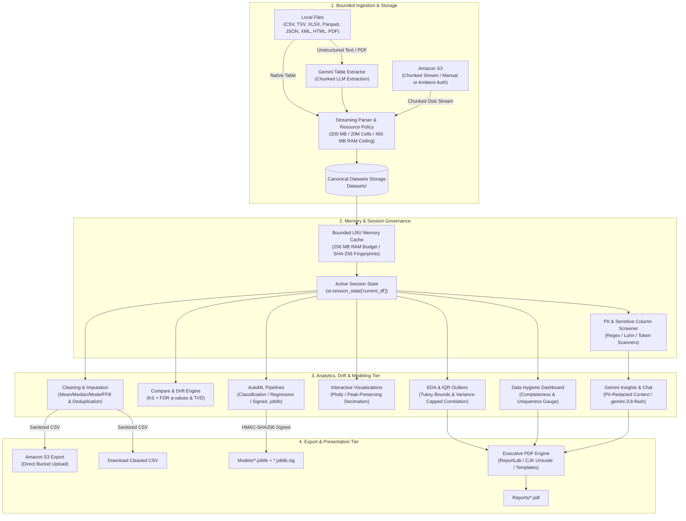

# CloudInsight AI — Complete Architectural & Technical System Specification
**Prepared for Gemini 4 Argon**
**Document Version:** 2.2.0 | **Target Platform:** Python 3.11 / 3.12 / 3.13 | **UI Framework:** Streamlit 1.60

---

## 1. Executive Summary & Mission

**CloudInsight AI** is an enterprise-grade, local-first data analytics, machine learning, and business intelligence platform built using Python, Streamlit, pandas, scikit-learn, Plotly, ReportLab, and Google Gemini.

### Primary Objectives & Core Philosophy
1. **Local-First & Data Sovereign:** All data ingestion, transformation, exploratory analysis, statistical modeling, machine learning training, and report generation execute locally within the user's execution environment. No customer data is transmitted to external servers unless the user explicitly invokes optional Google Gemini or Amazon S3 features.
2. **Defense-in-Depth Security:** Every layer of ingestion and computation enforces strict boundaries:
   - File size and dimensional limits preventing resource exhaustion (Decompression bomb guards, ZIP/XLSX limits, Parquet metadata verification, XML XXE rejection).
   - In-memory ephemeral secret governance (AWS credentials and Gemini API keys reside in volatile `st.session_state` and never touch disk).
   - Cryptographic model signing (HMAC-SHA256 signature verification over serialized `.joblib` bundles before deserialization prevents arbitrary bytecode execution).
   - Formula-injection neutralization (`sanitize_for_csv_export()`) protecting client spreadsheet software upon external CSV export while preserving lossless canonical numbers for internal data science.
   - Automated PII and credential screening before transmitting context to external LLMs.
3. **Statistical Rigor:** Dataset drift detection uses two-sample Kolmogorov-Smirnov (KS) tests with Benjamini-Hochberg False Discovery Rate (FDR) corrections for numeric series and Total Variation Distance (TVD) for categorical series. Machine learning pipelines prevent data leakage by isolating imputation and scaling inside scikit-learn `Pipeline` and `ColumnTransformer` constructs, validated on untouched holdout sets and cross-validation folds.
4. **Resilient User Experience:** Clean typography (Inter/Segoe UI), high-contrast dual-mode palettes (Light/Dark), responsive Plotly chart wrappers, peak-preserving time-series decimation, and defensive UX patterns preventing credential auto-wiping or browser freezes.

---

## 2. High-Level Architecture & End-to-End Data Flow

The system is organized into four interconnected tiers:



---

## 3. Directory & File Inventory

```text
CloudInsightAI/
├── App.py                          # Streamlit application entry point, routing, and home page
├── pyproject.toml                  # Project metadata, pytest, and ruff linting configuration
├── requirements.txt                # Base dependency constraints
├── requirements-lock.txt           # Pinned lockfile matching continuous integration environment
├── SECURITY.md                     # Security policy, threat model, and vulnerability reporting
├── README.md                       # Comprehensive setup and feature documentation
├── Datasets/                       # Canonical repository storage for ingested and cleaned datasets
│   ├── .conversions.json           # Manifest tracking provenance of AI-converted datasets
│   ├── saas_customers_q1.csv       # Default sample dataset (605 rows, synthetic customer churn)
│   └── saas_customers_q2_drifted.csv # Sample dataset with deliberate statistical distribution drift
├── Models/                         # Directory storing serialized models and signatures
│   ├── .model_signing_key          # 32-byte cryptographically secure HMAC signing key (mode 0600)
│   ├── *.joblib                    # Scikit-learn trained pipelines saved via joblib
│   └── *.joblib.sig                # JSON signature envelopes containing HMAC-SHA256 digests
├── Reports/                        # Generated PDF analytics reports
│   └── templates/                  # Saved JSON configuration presets for PDF generation
├── screenshots/                    # Complete localhost verification captures & documentation
│   ├── 01_home_empty.png ... 18_pdf_report_generator.png
│   └── README.md                   # Visual tour and feature usage guide
├── Pages/                          # Streamlit multipage application modules
│   ├── Upload.py                   # Ingest data: Local files, S3 import/export, Gemini converter
│   ├── Cleaning.py                 # Data cleaning: Deduplication, imputation, S3 export expander
│   ├── Compare.py                  # Dataset comparison: Schema diffs, KS test, TVD drift
│   ├── EDA.py                      # Exploratory data analysis: Dtypes, missingness, stats, IQR outliers
│   ├── Visualization.py            # Plotly charts: Histograms, Box/Violin, Scatter, Line, Composition
│   ├── Dashboard.py                # Data Hygiene Index gauge, live multi-column filtering, KPI distributions
│   ├── ML.py                       # AutoML: Problem detection, training, evaluation metrics, prediction
│   ├── AI.py                       # Gemini executive summaries, PII redaction, conversational Q&A
│   └── Report.py                   # PDF executive reports, template management, batch report generator
├── Utils/                          # Domain logic, security guards, and analytical math
│   ├── paths.py                    # Path containment, streaming parsers, resource limits, file hashing
│   ├── dataset_ui.py               # Session state management, bounded LRU RAM cache, active dataset
│   ├── secrets.py                  # Ephemeral in-memory credential storage and auto-clearing
│   ├── S3.py                       # Amazon S3 integration: Chunked streaming, ambient IAM, error diagnostics
│   ├── Preprocessing.py            # Imputation engines, deduplication, row-dropping strategies
│   ├── compare_logic.py            # Mathematical implementation of KS tests, FDR, TVD, and metric shifts
│   ├── sampling.py                 # Centralized sampling policy (25k visualization / 50k analysis)
│   ├── quality.py                  # Data Hygiene Index formulation (completeness & uniqueness)
│   ├── Charts.py                   # Plotly figure builders, hue category capping, OLS trendlines
│   ├── ML.py                       # Scikit-learn pipelines, HMAC model signing, cross-validation, metrics
│   ├── Gemini.py                   # Google Gemini API wrapper, dual SDK support, exponential backoff
│   ├── AIConvert.py                # Prompt generation and chunked text-to-table conversion engine
│   ├── PDF.py                      # ReportLab PDF generator, CJK Unicode font discovery, table layouts
│   ├── privacy.py                  # Heuristic sensitive data screening (PII, tokens, cards, IBANs)
│   ├── batch.py                    # Multi-file upload concatenation and provenance tagging
│   ├── theme.py                    # Design tokens, CSS injection, Light/Dark styling, Plotly templates
│   └── logsys.py                   # Centralized, privacy-safe application logging to stderr
└── tests/                          # 7 automated test suites (479 unit, security, and UI workflow tests)
    ├── test_security_boundaries.py # Path traversal, XXE, decompression bombs, HMAC verification
    ├── test_core_pipeline.py       # Ingestion limits, normalization, cleaning, formatting, deduplication
    ├── test_ingestion_parsers.py   # Format parsers (CSV, TSV, Parquet, JSON, XML, HTML, S3)
    ├── test_ml_and_drift.py        # Scikit-learn training, leakage prevention, KS/TVD drift math
    ├── test_ai_conversion.py       # Gemini conversion prompts, chunking, schema reconciliation
    ├── test_ui_workflows.py        # Streamlit AppTest headless UI navigation and state tests
    └── test_page_smoke.py          # End-to-end smoke tests checking all pages render without exceptions
```

---

## 4. Deep Module-by-Module Technical Analysis

### 4.1 Ingestion, Storage & Security Core (`Utils/paths.py`)

`Utils/paths.py` (2,146 lines) forms the defensive foundation of the entire application. It governs all filesystem interactions, parsing, and memory budgets.

#### Central Resource Policy Constants
```python
MAX_UPLOAD_BYTES = 200 * 1024 * 1024            # 200 MB maximum single-file upload ceiling
MAX_AGGREGATE_UPLOAD_BYTES = 250 * 1024 * 1024  # 250 MB multi-file batch upload ceiling
MAX_UPLOAD_FILES = 20                           # Maximum files permitted in a single upload batch
MAX_INGESTION_ROWS = 1_000_000                  # 1 Million rows hard upper limit
MAX_INGESTION_COLUMNS = 200                     # 200 columns hard upper limit
MAX_INGESTION_CELLS = 20_000_000                # 20 Million cells (rows × columns) upper limit
MAX_DATAFRAME_MEMORY_BYTES = 400 * 1024 * 1024  # 400 MB deep in-memory DataFrame memory budget
MAX_HIGH_CARDINALITY_STRING_CELLS = 5_000_000   # Guard against high-cardinality string allocations
```

#### Filesystem & Path Containment
- `safe_stem(value, fallback="model", max_len=100)`:
  - Strips all path separators (`/`, `\`, `:`), path traversal tokens (`..`), and non-alphanumeric characters (preserving only letters, digits, spaces, hyphens, and underscores).
  - Explicitly rejects and renames **Windows Reserved Device Names**: `CON`, `PRN`, `AUX`, `NUL`, `COM1`–`COM9`, `LPT1`–`LPT9` by appending `_safe`.
  - Enforces a strict 100-character ceiling to prevent filesystem path length exhaustion.
- `resolve_dataset_path(dataset)`:
  - Resolves filenames strictly against `DATASETS_DIR`. If a caller supplies an absolute path or relative path escaping `DATASETS_DIR`, it validates `path.resolve().is_relative_to(DATASETS_DIR)`. Any violation raises a `ValueError` immediately.
- `get_unique_filename(filename, directory=DATASETS_DIR, extra_names=None)`:
  - Ensures collision-free filenames using deterministic numbering: `data.csv` → `data_1.csv` → `data_2.csv`.
  - Implements **atomic cross-thread and cross-process reservations** using low-level kernel flags `os.O_CREAT | os.O_EXCL | os.O_WRONLY` writing temporary `.reserve` marker files with 60-second TTL cleanup to guarantee zero race conditions during concurrent uploads.
- `atomic_write(target_path, content, mode="w", encoding="utf-8")`:
  - Writes data first to a unique temporary file (`target_path.tmp.<uuid>`) in the same directory, flushes to disk, and executes `os.replace` (atomic file substitution on POSIX and Windows NTFS).

#### Format Parsers & Security Controls
1. **Delimited Text (CSV / TSV)**:
   - Evaluates multi-encoding fallback: `utf-8-sig`, `utf-8`, `cp1252`, `latin1`.
   - Streaming inspection (`_inspect_delimited_header_width`) determines column count before allocating memory. If column count exceeds 200, parsing halts immediately.
   - Computes maximum allowed rows based on `MAX_INGESTION_CELLS // num_cols`.
   - Employs `_check_string_cardinality_amplification` to detect pathological high-cardinality string inputs before memory allocation.
2. **Spreadsheet Files (Excel `.xlsx` and legacy `.xls`)**:
   - `_check_zip_bomb(buffer, max_uncompressed_bytes=100MB, max_ratio=100.0)` inspects zip archive directory headers of `.xlsx` files before opening with `openpyxl`. Rejects files exceeding 100 MB uncompressed or having compression ratios over 100x.
   - Legacy `.xls` requires the `xlrd>=2.0.1` package; if absent, a clear educational exception is surfaced to the user.
3. **Parquet Files (`.parquet`)**:
   - Uses `pyarrow.parquet.ParquetFile` to inspect file metadata (`num_rows`, `num_columns`) directly from the footer without reading row groups into memory.
   - If metadata indicates `total_rows > 1,000,000` or `total_cells > 20,000,000`, the file is rejected with zero byte deserialization.
   - Reads data via bounded batches (`pf.iter_batches(batch_size=10000)`).
4. **JSON & JSONL / NDJSON**:
   - Flat and nested JSON arrays are streamed with bracket-matching state machines (`_stream_json_array`) to avoid materializing multi-hundred-megabyte JSON DOM trees in Python memory.
   - JSONL/NDJSON reads lines sequentially with `_read_jsonl_from_buffer`, enforcing line and cell budgets.
5. **XML (`.xml`)**:
   - **XXE & Entity Expansion Defense**: `_reject_dtd(payload)` registers a customized Expat XML parser where `EntityDeclHandler`, `ExternalEntityRefHandler`, and `DTDHandler` throw fatal exceptions.
   - Recursively flattens elements up to `MAX_XML_DEPTH = 6` (`_flatten_xml_element`).
6. **HTML Tables (`.html`, `.htm`)**:
   - Custom `_HTMLTableParser(HTMLParser)` extracts tabular structures from `<table>`, `<tr>`, `<td>`, `<th>` tags.
   - Rejects complex `rowspan` hierarchies with `AIConversionRequired`, delegating complex tables to Gemini.
7. **Plain Text & PDF (`.txt`, `.log`, `.pdf`)**:
   - Plain text uses `csv.Sniffer` to evaluate if a delimiter exists. If sniffing fails or data represents free-form prose/logs, it raises `AIConversionRequired(raw_text=...)`.
   - PDFs are parsed via `pypdf.PdfReader` up to 30 pages / 50,000 characters, raising `AIConversionRequired` so users can invoke Gemini table extraction.
8. **Formula Injection Sanitization (`sanitize_for_csv_export(df)`)**:
   - Neutralizes formula triggers in external CSV/Excel exports. If any string cell begins with `=`, `+`, `-`, `@`, `\t`, or `\r`, it prepends a single quote (`'`). Internal data structures remain unaltered to preserve scientific precision.

---

### 4.2 Session State & Bounded In-Memory Cache (`Utils/dataset_ui.py`)

#### Core Session State Contract
Every page in CloudInsight AI references a centralized session contract:
- `st.session_state["current_df"]`: The active pandas `DataFrame`.
- `st.session_state["dataset_name"]`: The canonical filename or session label.
- `st.session_state["session_fingerprint"]`: Cryptographic SHA-256 fingerprint tracking file or dataframe modification.

#### Cryptographic Content Fingerprinting
- `dataset_fingerprint(dataset, force_refresh=False)`:
  - Calculates a full SHA-256 cryptographic digest of the raw file on disk using 64 KB streaming chunks.
  - Caches digests against `(path, st_mtime_ns, st_size)`. When verifying model provenance or critical state, `force_refresh=True` bypasses the cache to detect in-place file modifications.
- `dataframe_fingerprint(df)`:
  - Generates a deterministic content digest for in-memory DataFrames:
  $$\text{hash}(\text{shape} \parallel \text{columns} \parallel \text{dtypes} \parallel \text{pd.util.hash\_pandas\_object}(df))$$
  - Includes a fallback for unhashable Python objects (lists/dicts) via canonical JSON serialization.

#### Bounded LRU Dataset Memory Cache (`BoundedDatasetMemoryCache`)
- Implements an LRU cache with a hard **256 MB RAM budget** (`MAX_DATASET_CACHE_BYTES`).
- Tracks deep memory usage via `df.memory_usage(index=True, deep=True).sum()`.
- Evicts the oldest datasets when cache size exceeds 256 MB. Single datasets exceeding the budget are served un-cached.
- Enforces a **copy-on-read contract** (`return df.copy(deep=True)`), ensuring downstream modifications on one page cannot mutate cached structures.

---

### 4.3 Ephemeral Secrets Management (`Utils/secrets.py`)

CloudInsight AI enforces zero-disk secret persistence:
- `ask(name, label, help_text)` renders a password-masked input (`st.text_input(..., type="password")`).
- Secret values are stored exclusively in volatile `st.session_state[f"{name}_secret"]`.
- `keep_box(session_key)` provides a user-facing checkbox: *"Keep in session state for this session"*.
- `release(*names, keep_key=None)` wipes the secret from session memory immediately upon task completion unless the user explicitly ticked the keep box.
- `temporary_secret(*names, keep_key=None)` provides a Python context manager ensuring secrets are wiped in a `finally` block even if unexpected exceptions or network timeouts occur.

---

### 4.4 Amazon S3 Integration & IAM Governance (`Utils/S3.py`)

`Utils/S3.py` provides resilient, bidirectional integration with Amazon S3.

#### Gotchas Resolved in the Implementation
1. **Gotcha 1 (Credential Auto-Wipe UX Trap):** Previously, listing bucket objects in a `finally` block purged credentials from memory, causing downstream file selectors and inputs to collapse. Resolved by decoupling credential retention from intermediate list operations, providing an explicit **Clear keys** button.
2. **Gotcha 2 (Temporary Credentials & Session Tokens):** Added `aws_session_token` parameter to `get_s3_client()` and exposed the **AWS Session Token (Optional)** input field in the UI. Enables authentication via temporary STS tokens, AWS SSO, and IAM role assumption.
3. **Gotcha 3 (Ambient IAM Roles / Environment / AWS CLI Fallback):** `get_s3_client()` accepts optional credentials. If access keys are omitted, boto3 automatically evaluates its standard credential resolution chain:
   - Environment variables (`AWS_ACCESS_KEY_ID`, `AWS_SECRET_ACCESS_KEY`, `AWS_SESSION_TOKEN`)
   - Shared credential file (`~/.aws/credentials`) and config (`~/.aws/config`)
   - EC2 Instance Metadata Service (IMDSv2) / ECS task roles / EKS IAM roles for service accounts (IRSA).
4. **Gotcha 4 (Exact IAM Error Diagnostics):** `describe_s3_error(error, action=..., bucket=...)` maps `ClientError` and `AccessDenied` exceptions into exact IAM permissions and resource ARNs:
   - `action="list"`: Alerts the user that `s3:ListBucket` is required on bucket ARN `arn:aws:s3:::bucket-name`.
   - `action="download"`: Alerts the user that `s3:GetObject` is required on object ARN `arn:aws:s3:::bucket-name/*`.
   - `action="upload"`: Alerts the user that `s3:PutObject` is required on object ARN `arn:aws:s3:::bucket-name/*`.
5. **Gotcha 8 (S3 Dataset Export):** Implemented `upload_s3_dataset()`, allowing users to upload active or cleaned datasets directly to an S3 bucket with optional formula sanitization.

#### S3 Streaming & Bounded Downloads
- `download_s3_dataset()` streams the S3 object body into a bounded temporary file on disk using 64 KB chunks, enforcing `MAX_UPLOAD_BYTES = 200MB` during streaming. It replaces the destination atomically without loading the entire payload into RAM multiple times.
- `list_s3_datasets()` paginates via `list_objects_v2` with continuation tokens, defended by a ceiling of `MAX_S3_OBJECTS_SCAN = 20,000` to prevent infinite pagination loops.

---

### 4.5 Data Cleaning & Preprocessing (`Utils/Preprocessing.py`, `Pages/Cleaning.py`)

#### Deduplication
- `remove_duplicates(df)` executes `df.drop_duplicates().reset_index(drop=True)`.

#### Imputation Strategies
- `fill_missing_values(df, numeric_strategy, categorical_strategy, datetime_strategy)`:
  - **Numeric Strategies:**
    - `mean`: Imputes column mean. If all values are missing or infinite, imputes `0`.
    - `median`: Imputes column median (robust to extreme outliers).
    - `zero`: Imputes `0.0`.
  - **Categorical Strategies:**
    - `mode`: Imputes most frequent category; falls back to `"Unknown"` if tie or empty.
    - `unknown`: Explicitly imputes string label `"Unknown"`.
  - **Datetime Strategies:**
    - `ffill`: Forward-fill in sequential row order. **Prevents temporal lookahead leakage** when time-series data is ordered chronologically.
    - `ffill_bfill`: Forward-fill followed by backward-fill for leading nulls.
    - `none`: Preserves null datetime values untouched.
- `drop_missing_values(df, threshold=None)`:
  - Drops rows containing nulls. If `threshold` is provided (e.g., `0.5`), drops columns where missingness exceeds the threshold before dropping remaining rows.

#### Export Integration
- Saves cleaned datasets under collision-safe names: `cleaned_<stem>.csv` → `cleaned_<stem>_1.csv`.
- Features an expandable **📤 Export cleaned dataset to Amazon S3** panel for immediate cloud backup.

---

### 4.6 Dataset Comparison & Statistical Drift Engine (`Utils/compare_logic.py`, `Pages/Compare.py`)

Compares two datasets (Dataset A vs Dataset B) at schema and distributional levels:

#### Schema Diffing
- `schema_diff(df_a, df_b)` computes:
  - $\text{Common} = \text{Cols}_A \cap \text{Cols}_B$
  - $\text{Only in A} = \text{Cols}_A \setminus \text{Cols}_B$
  - $\text{Only in B} = \text{Cols}_B \setminus \text{Cols}_A$

#### Summary Metric Shifts
- **Relative Mean Shift:**
  $$\Delta\% = \frac{\mu_B - \mu_A}{|\mu_A|} \times 100 \quad (\text{for } |\mu_A| > 10^{-12})$$
  For near-zero baselines ($|\mu_A| \le 10^{-12}$), reports absolute difference $\mu_B - \mu_A$ labeled `N/A (baseline ≈ 0)` to prevent mathematically invalid percentage blowups.
- **Dispersion Shift:** Flags standard deviation ratio if $\frac{\sigma_B}{\sigma_A} \ge 1.5$ or $\le 0.67$.
- **Missingness Drift:** Flags columns if $|\text{Missingness}_B - \text{Missingness}_A| \ge 10.0\%$.

#### Distribution Drift: Two-Sample Kolmogorov-Smirnov (KS) Test
For numeric columns with at least 10 finite samples:
- Computes empirical cumulative distribution functions $F_A(x)$ and $F_B(x)$.
- Test statistic:
  $$D = \sup_x |F_A(x) - F_B(x)|$$
- **Multiple Testing Correction:** Multiple hypothesis tests across dozens of columns induce False Discovery Rate inflation. `benjamini_hochberg_correction(p_values)` computes Benjamini-Hochberg FDR-adjusted q-values:
  $$q_{(i)} = \min \left( 1.0, \min_{k \ge i} \left( \frac{m}{k} p_{(k)} \right) \right)$$
  Flags distribution drift when $q < 0.05$ (or $p < 0.01$ if single test).

#### Categorical Drift: Total Variation Distance (TVD)
For categorical columns with at least 10 samples:
- Computes normalized probability mass vectors $P_A$ and $P_B$ over the union of categories $\Omega$:
  $$\text{TVD} = \frac{1}{2} \sum_{c \in \Omega} |P_A(c) - P_B(c)|$$
  $\text{TVD} \in [0.0, 1.0]$. Flags categorical drift when $\text{TVD} \ge 0.20$.

---

### 4.7 Exploratory Data Analysis & Outlier Detection (`Pages/EDA.py`)

- **Structural Profiling:** Columns, data types, non-null counts, null percentages, unique cardinalities.
- **Descriptive Statistics:** Numerical tab (count, mean, std, min, 25%, 50%, 75%, max) and Categorical tab (count, unique, top, freq).
- **Variance-Capped Correlation Matrix:** If numeric features exceed 50, selects the top 50 columns ranked by variance to prevent browser freezing. Formats with a `coolwarm` background gradient.
- **Tukey's Interquartile Range (IQR) Outlier Detection:**
  - Computes first quartile $Q_1$ (25th percentile) and third quartile $Q_3$ (75th percentile).
  - Interquartile Range: $\text{IQR} = Q_3 - Q_1$.
  - Bounds:
    $$\text{Lower Bound} = Q_1 - 1.5 \times \text{IQR}, \quad \text{Upper Bound} = Q_3 + 1.5 \times \text{IQR}$$
  - Flags values $x < \text{Lower Bound}$ or $x > \text{Upper Bound}$, outputting outlier counts and percentages per numeric feature.

---

### 4.8 Interactive Visualizations & Decimation (`Utils/Charts.py`, `Pages/Visualization.py`)

#### Plotly Visualization Builders
- **Distributions:**
  - `create_histogram_plot()`: Interactive bin slider (5–100), marginal overlays (box, violin, rug), hue group overlay.
  - `create_box_violin_plot()`: Box and Violin plots with points toggling (outliers, all, suspectedoutliers, none).
- **Relational & Trends:**
  - `create_scatter_plot()`: X/Y feature selection, bubble size scaling, color hue encoding, and Ordinary Least Squares (OLS) trendline fitting via `statsmodels.api`.
  - `create_line_chart()`: Continuous line plotting with data marker toggles.
- **Categorical Composition:**
  - Bar/Count charts with customizable aggregations (`Count`, `Sum`, `Mean`, `Median`, `Min`, `Max`).
  - Pie charts, Donut charts, and hierarchical Treemaps.
- **Correlation Heatmap:**
  - `create_correlation_heatmap()`: Interactive annotated 2D heatmap with Plotly color scales.

#### Performance & Responsiveness Controls
- **High-Cardinality Hue Capping:** `_cap_hue_column(df, hue_col, max_categories=20)` inspects grouping variables. If distinct categories exceed 20, keeps the top 20 and pools all remaining categories into `"Other"`, preventing browser DOM crashes.
- **Peak-Preserving Time-Series Decimation (`downsample_timeseries`)**:
  - Downsamples large time-series datasets to 25,000 points using min-max envelope bucketing. Preserves local peaks, troughs, and temporal boundaries rather than naive random dropping.
- **Visualization Sampling (`sample_for_visualization`)**:
  - Deterministically samples 25,000 rows (`random_state=42`) for scatter plots exceeding 25,000 records, adding an informative UI caption to ensure complete transparency.

---

### 4.9 Executive Health Dashboard (`Utils/quality.py`, `Pages/Dashboard.py`)

#### Data Hygiene Index Formulation
The Data Hygiene Index is an authoritative structural metric defined in `Utils/quality.py`:
$$\text{Completeness} = \frac{\text{Total Cells} - \text{Missing Cells}}{\text{Total Cells}} \times 100$$
$$\text{Uniqueness} = \frac{\text{Total Rows} - \text{Duplicate Rows}}{\text{Total Rows}} \times 100$$
$$\text{Data Hygiene Index} = \frac{\text{Completeness} + \text{Uniqueness}}{2}$$

- Visualized via a Plotly radial gauge ($0$–$100$ scale) color-coded into danger ($0$–$50$), warning ($50$–$80$), and healthy ($80$–$100$) bands with a target threshold at $90$.
- Both the Dashboard page and the PDF Report engine import this exact formulation to guarantee 100% metric consistency across surfaces.

#### Live Multi-Column Filtering
- Users select any combination of columns to filter simultaneously.
- **Numeric Columns:** Interactive continuous range slider with min/max bounds.
- **Low-Cardinality Categoricals ($\le 50$ unique):** Multi-select tag filter with an explicit `(Missing / Null)` option.
- **High-Cardinality Categoricals ($> 50$ unique):** Case-insensitive substring search box.
- All filters evaluate reactively in real time, updating downstream metric cards and preview tables without full-page reloads.

---

### 4.10 AutoML Pipeline & HMAC-SHA256 Model Security (`Utils/ML.py`, `Pages/ML.py`)

#### Problem Type Detection
`detect_problem_type(df, target_col)`:
- Categorical / string dtypes → **Classification**.
- Boolean dtypes → **Classification**.
- Integer / float dtypes with $\le 10$ unique values and $< 5\%$ cardinality ratio → **Classification**.
- Continuous floats / high-cardinality numbers → **Regression**.

#### Supported Algorithms
- **Classification:**
  - `Logistic Regression` (`max_iter=1000`)
  - `Decision Tree Classifier`
  - `Random Forest Classifier` (`n_estimators=100, max_depth=15, min_samples_leaf=2`)
  - `Gradient Boosting Classifier`
- **Regression:**
  - `Linear Regression`
  - `Ridge Regression`
  - `Random Forest Regressor` (`n_estimators=100, max_depth=15, min_samples_leaf=2`)
  - `Gradient Boosting Regressor`

#### Preprocessing & Leak-Free Pipeline Architecture
To eliminate data leakage, all transformations execute strictly inside scikit-learn `Pipeline` objects:
- **Numeric Features Pipeline:**
  $$\text{Input} \longrightarrow \text{SimpleImputer(strategy='median')} \longrightarrow \text{StandardScaler()} \longrightarrow \text{Model}$$
- **Categorical Features Pipeline:**
  $$\text{Input} \longrightarrow \text{SimpleImputer(strategy='most_frequent')} \longrightarrow \text{OneHotEncoder(handle\_unknown='ignore')} \longrightarrow \text{Model}$$
- **Dense One-Hot Encoding Explosion Guard:**
  $$\text{Estimated Encoded Cells} = \text{Rows} \times \left( |\text{Num Features}| + \sum_{c \in \text{Cat Features}} \text{nunique}(c) \right)$$
  If estimated encoded cells exceed `ML_MAX_TRAIN_CELLS = 5,000,000`, training aborts immediately with an actionable error identifying high-cardinality columns.

#### Cross-Validation & Validation Modes
1. **Holdout Evaluation:** Clean train/test split ($10\%$ to $40\%$). Uses `StratifiedKFold` when class balance permits; falls back to unstratified with explicit warning if rare classes have $< 2$ instances.
2. **TimeSeriesSplit:** When temporal features exist, `TimeSeriesSplit` evaluates forward in time without shuffling, eliminating lookahead bias.
3. **K-Fold CV on Training Population:** 5-fold cross-validation is evaluated strictly on $(X_{\text{train}}, y_{\text{train}})$, keeping holdout test data strictly untouched. Reports mean $\pm$ standard deviation.
4. **Baseline Dummy Model:** Trains `DummyClassifier(strategy='most_frequent')` or `DummyRegressor(strategy='mean')` on the exact same splits to verify whether complex models outperform naive majority guessing.

#### Evaluation Metrics
- **Classification:** Accuracy, Precision (weighted), Recall (weighted), F1-score (weighted and macro), Confusion Matrix, ROC curves (One-vs-Rest for multiclass).
- **Regression:** $R^2$ Score, Mean Absolute Error (MAE), Root Mean Squared Error (RMSE), Residual scatter plots.

#### HMAC-SHA256 Cryptographic Model Security
`joblib` deserializes arbitrary Python bytecode. To prevent remote code execution (RCE) vulnerabilities:
- `_get_or_create_model_signing_key()` creates an atomic 32-byte secret key at `Models/.model_signing_key` with strict permissions (`0600`).
- `sign_model_artifact(model_path)` computes an HMAC-SHA256 signature across model bytes, saving `model.joblib.sig`:
  ```json
  {
    "model_file": "model.joblib",
    "algo": "hmac-sha256",
    "signature": "<hex-hmac-sha256-digest>",
    "created_at": "2026-10-16T15:00:00"
  }
  ```
- `load_trained_model(path, require_signature=True)`:
  - Enforces path containment inside `MODELS_DIR`.
  - Recomputes HMAC-SHA256 over `.joblib` bytes and verifies against `.joblib.sig` using constant-time comparison `hmac.compare_digest`.
  - Unsigned, tampered, or externally placed model files are blocked before `joblib.load()` executes.
- Models store the SHA-256 fingerprint of the training dataset in metadata for complete audit provenance.

---

### 4.11 Google Gemini Integration & Privacy Redaction (`Utils/Gemini.py`, `Utils/privacy.py`, `Utils/AIConvert.py`, `Pages/AI.py`)

#### Central Model Registry & Deprecation Mapping
- **Default Model:** `gemini-3.8-flash`
- **Supported Models:** `gemini-3.8-flash`, `gemini-3.5-flash`, `gemini-2.5-flash`, `gemini-2.5-pro`
- **Automatic Forward Mapping:** Retired 1.x and 2.0 models map forward automatically:
  - `gemini-1.5-flash`, `gemini-2.0-flash` $\longrightarrow$ `gemini-3.8-flash`
  - `gemini-1.5-pro`, `gemini-1.0-pro`, `gemini-pro` $\longrightarrow$ `gemini-2.5-pro`

#### Dual SDK Support
`Utils/Gemini.py` implements dual SDK resilience:
1. Primary modern SDK: `from google import genai` (`google-genai` client).
2. Fallback legacy SDK: `import google.generativeai as legacy_genai`.

#### Automated Privacy Screening (`Utils/privacy.py`)
Before constructing LLM context, `detect_sensitive_columns(df)` screens column names and cell samples:
- **Regex Patterns:** Email addresses, IBAN account numbers, Credit card numbers (validated via **Luhn algorithm** checksum), Phone numbers, JWT tokens, API keys (`sk-`, `AKIA`, `AIza`, `ghp_`).
- **Phone Number Heuristics:** Detects numeric columns holding 10–15 digit integers, while intelligently ignoring Unix epoch timestamps (seconds between 2001 and 2038).
- Sensitive columns are automatically pre-selected in the UI for exclusion. Excluded columns are purged before prompt assembly.

#### Unstructured Document Table Extraction (`Utils/AIConvert.py`)
Converts raw text, unformatted PDFs, server logs, or malformed HTML tables into structured CSV tables:
- **Prompt Injection Defense:** Input text is sandboxed within `<source_file>` tags, and closing tags `</source_file>` are escaped to prevent prompt breakout.
- **Chunked Processing:** Texts larger than 12,000 characters are split at semantic paragraph breaks (`\n\n`), passing continuation prompts to Gemini to maintain schema consistency across multi-chunk files.
- **Deterministic Delimiter Normalization:** Normalizes markdown code fences, extracts valid CSV lines, ensures header snake_case formatting, and deduplicates columns.

#### Context-Bounded Chat & Insights
- Executive Insights summarizes dataset health, anomalous patterns, correlations, and strategic recommendations.
- Interactive Chat enables natural language queries against dataset summaries.
- `prune_ai_contexts(session_state, current_ctx_hash)` enforces an LRU memory lifecycle (max 10 contexts) to prevent unbounded memory growth during long sessions.

---

### 4.12 Executive PDF Reporting Engine (`Utils/PDF.py`, `Pages/Report.py`)

Generates formal, publication-ready PDF analytics reports using ReportLab.

#### Document Architecture & Layout Governance
- Page Size: Standard US Letter ($8.5 \times 11$ inches).
- Usable Width: $540\text{ pt}$ ($612\text{ pt} - 2 \times 36\text{ pt}$ margins).
- Two-Pass Page Numbering: Custom `NumberedCanvas` computes exact `"Page X of Y"` pagination footers across arbitrary document lengths.

#### CJK & TrueType Unicode Font Discovery
ReportLab's default `Helvetica` crashes on non-ASCII characters. `_resolve_pdf_fonts()` probes the host system:
1. Searches for CJK-capable system fonts: `Microsoft YaHei`, `SimSun`, `SimHei`, `Malgun Gothic`, `MS Gothic`, `Arial Unicode MS`, `Noto Sans CJK`.
2. Falls back to matplotlib's bundled `DejaVuSans.ttf` / `DejaVuSans-Bold.ttf`.
3. Falls back gracefully to `Helvetica`.

#### Report Content Sections
1. **Header & Metadata:** Report title, author, generation timestamp, active dataset name.
2. **Executive Summary & Data Hygiene Index:** Structural hygiene score, completeness rate, uniqueness rate, record and column totals.
3. **Column Structure Table:** Column names, dtypes, non-null counts, missingness percentages, unique cardinalities.
4. **Descriptive Statistics:** Numerical statistics (count, mean, std, min, quartiles, max) wrapped in formatted tables.
5. **Tukey IQR Outlier Analysis:** Outlier counts, percentages, and upper/lower fences.
6. **Correlation Analysis:** Top feature pairings by Pearson correlation coefficient.
7. **Sample Data Records:** Tabular preview of the first 5 records with XML escaping to prevent ReportLab markup injection.
8. **Isolated Matplotlib Visualizations (Optional):** Histograms, Box plots, and Correlation Heatmaps rendered in isolated subplots with `matplotlib.use('Agg')` and explicit figure closing (`plt.close(fig)`) to eliminate memory leaks.
9. **Gemini AI Insights (Optional):** Full executive recommendations generated by Gemini.

#### Configuration Templates & Batch Mode
- Report configurations (title, author, chart toggles, AI toggles, excluded columns) can be saved to `Reports/templates/<name>.json` with overwrite protection.
- **Batch Report Generation:** Automatically iterates over every ready dataset in `Datasets/`, generating individual PDF reports in a single automated batch run.

---

### 4.13 Design System & Theme Engine (`Utils/theme.py`)

A unified visual design system eliminating ad-hoc CSS hacks:
- **Typography:** `Inter`, `Segoe UI`, system-ui, -apple-system.
- **Palette Tokens:**
  - **Light Mode:** High-contrast slate typography (`--ci-text: #0F172A`, `--ci-text-2: #334155`), clean white background (`#FFFFFF`), light border (`rgba(100, 116, 139, .22)`), solid primary accent (`#2563EB`).
  - **Dark Mode:** Soft dark background (`#0B0F19`), crisp text (`#F8FAFC`, `#CBD5E1`), subtle surface cards (`#111827`), blue accent (`#3B82F6`).
- **Button & Control Consistency:** Standardized button heights (`2.35rem`), prominent solid primary buttons (`type="primary"`), subtle borders on secondary buttons, and rounded corners (`8px`).
- **Plotly Template Sync:** `plot_template()` returns a customized Plotly template matching the active UI theme (backgrounds, gridlines, fonts, and chart color sequences).

---

## 5. Automated Test Suite & Security Verification

CloudInsight AI maintains **479 automated unit, security, integration, and UI tests** across 7 test modules:

```text
Ran 479 tests in 41.230s
OK
```

### Test Suite Breakdown

| Test File | Test Count | Domains & Invariants Tested |
| :--- | :---: | :--- |
| `tests/test_security_boundaries.py` | ~85 | Path containment (`safe_stem`), directory traversal rejection, Windows reserved names, Zip bomb expansion ratios, XML XXE rejection, HMAC-SHA256 signature tampering, formula injection neutralization. |
| `tests/test_core_pipeline.py` | ~110 | Streaming parser limits (200 MB, 1M rows, 200 cols, 20M cells), DataFrame memory budgets, column deduplication, missing value imputation, deduplication, atomic writing. |
| `tests/test_ingestion_parsers.py` | ~75 | Format-specific parsers (CSV, TSV, XLSX, XLS, Parquet, JSON, JSONL, XML, HTML, PDF), AWS S3 ambient fallback, action-specific IAM error mapping (`describe_s3_error`). |
| `tests/test_ml_and_drift.py` | ~60 | Problem type detection, classification/regression training, preprocessing pipeline encapsulation, TimeSeriesSplit, KS test math, Benjamini-Hochberg FDR adjustments, TVD categorical drift. |
| `tests/test_ai_conversion.py` | ~45 | Gemini prompt generation, XML tag escaping, chunking at paragraph breaks, schema reconciliation, delimiter normalization, PII detection (Luhn credit cards, phone numbers). |
| `tests/test_ui_workflows.py` | ~40 | Headless UI workflows using Streamlit `AppTest`: S3 UI remediation tests (manual keys, ambient auth, session tokens, S3 export tab, credential retention), Cleaning S3 export expander. |
| `tests/test_page_smoke.py` | ~64 | Headless smoke tests verifying that every page in `Pages/` renders cleanly without runtime exceptions or missing import errors across active and empty session states. |

---

## 6. Localhost Visual Inventory & Usage Reference

All screenshots are stored in `screenshots/` (`c:\Users\Srikiran\CloudInsightAI\screenshots/`).

```text
screenshots/
├── 01_home_empty.png                   # Initial home page before loading data
├── 02_home_loaded.png                  # Home page with active dataset and sidebar counters
├── 03_ingest_local_file.png            # File drag-and-drop ingestion with format whitelist
├── 04_ingest_s3_manual_keys.png        # S3 manual auth with Access Key, Secret Key & Session Token
├── 05_ingest_s3_iam_ambient.png        # S3 automatic ambient auth (IAM role / AWS CLI)
├── 06_ingest_s3_export_tab.png         # S3 Export tab for uploading datasets to S3 buckets
├── 07_cleaning_options.png             # Cleaning page with hygiene metrics and imputation selectors
├── 08_cleaning_result_and_s3_export.png # Cleaned dataset results, CSV download & S3 export panel
├── 09_compare_datasets.png             # Schema diffing, KS test & TVD statistical drift tables
├── 10_eda_overview_and_correlations.png # Dtypes, stats, correlation matrix & IQR outlier tables
├── 11_visualize_distributions.png      # Interactive histogram with bin slider & marginal plots
├── 12_visualize_relational.png         # Scatter/bubble plot with hue grouping & OLS trendline
├── 13_visualize_composition.png        # Categorical bar/count chart with aggregations & pie charts
├── 14_dashboard_hygiene_index.png      # Data Hygiene Index gauge & live multi-column filters
├── 15_machine_learning_setup.png       # ML problem setup, feature selection & test split slider
├── 16_machine_learning_results.png     # ML evaluation metrics, confusion matrix & ROC curve
├── 17_ai_insights.png                  # Gemini executive insights & privacy column exclusion
├── 18_pdf_report_generator.png         # Executive PDF report configuration & template manager
└── README.md                           # Comprehensive screenshot usage guide
```

---

## 7. How to Run, Operate, and Extend CloudInsight AI

### 7.1 Environment Setup & Execution

#### Prerequisites
- Python 3.11, 3.12, or 3.13
- Virtual environment (`venv/`)

#### Launching the Application
```powershell
# 1. Activate Virtual Environment (Windows)
.\venv\Scripts\activate

# 2. Launch Streamlit Application
streamlit run App.py --server.port 8501 --server.address 127.0.0.1
```

Access the application in any web browser at:
```
http://127.0.0.1:8501
```

### 7.2 Headless Execution (Background Daemon Mode)
```powershell
$py = ".\venv\Scripts\python.exe"
Start-Process -FilePath $py `
  -ArgumentList '-m','streamlit','run','App.py','--server.port','8501',
                '--server.address','127.0.0.1','--server.headless','true',
                '--browser.gatherUsageStats','false' `
  -WorkingDirectory $PWD `
  -RedirectStandardOutput "$env:TEMP\cloudinsight.log" `
  -RedirectStandardError "$env:TEMP\cloudinsight.err" `
  -WindowStyle Hidden
```

Confirm health:
```powershell
Invoke-WebRequest http://localhost:8501 -UseBasicParsing
```

### 7.3 Executing Test Suites
```bash
# Run full unit and security suite
python -m unittest discover -s tests -v

# Run UI workflow tests
python -m unittest tests/test_ui_workflows.py -v

# Run code style & serious error check
ruff check --select=E9,F63,F7,F82,F821 --preview .
```

### 7.4 Extension Recipes

#### Recipe A: Adding a New Machine Learning Algorithm
1. Open `Utils/ML.py`.
2. Import the estimator from `sklearn`.
3. In `train_and_evaluate_model()`, add the algorithm name to the `if problem_type == "Classification":` or `"Regression":` block.
4. Open `Pages/ML.py` and append the algorithm name string to `algorithms = [...]`.

#### Recipe B: Adding a New Format Parser
1. Open `Utils/paths.py`.
2. Add the file extension (e.g., `.feather`) to `TABULAR_EXTENSIONS`.
3. Define `_read_<format>_from_buffer(buffer, nrows=None)`.
4. In `read_tabular()`, add an `elif suffix == ".feather":` branch calling the new reader.
5. Add unit tests in `tests/test_ingestion_parsers.py`.

#### Recipe C: Adding a New PDF Report Section
1. Open `Utils/PDF.py`.
2. In `generate_pdf_report()`, define the flowable elements (e.g. `Paragraph`, `Table`, `Spacer`).
3. Append flowables to the `story` list before calling `doc.build(story, canvasmaker=NumberedCanvas)`.

---

## 8. Enterprise Frontend Architecture & Visual QA Bug Fixes

Following visual inspection of live screenshots, the user interface and data-science defaults underwent a comprehensive redesign to eliminate "AI-generated script" visual anti-patterns while resolving 7 critical conceptual bugs:

### 8.1 Resolution of 7 Conceptual & Visual Bugs
1. **AutoML Feature Contamination (`Pages/ML.py` & `Utils/ML.py`):**
   - *Problem:* `customer_id` was auto-selected into `default` predictors, expanding into 480 sparse one-hot dummy columns and causing the Random Forest to collapse into predicting majority-class only (`F1 Macro = 45.21%`).
   - *Fix:* Added `is_likely_id_column(df, col)` detecting `_id`, `uuid`, `index` and high-cardinality strings (`nunique / len(df) > 0.5`). High-cardinality ID features remain selectable in multiselect `options`, but are auto-excluded from `default` selection with a clean informational badge.
2. **Broken Categorical Chart Defaults (`Pages/Visualization.py`):**
   - *Problem:* `Category (X-Axis)` defaulted to the first column in the DataFrame (`customer_id`), rendering an unusable 600-bar frequency plot.
   - *Fix:* Implemented `rank_categorical_candidates()` sorting columns by cardinality (`2 <= nunique <= 30` non-ID dimensions like `plan_tier` appear first).
3. **Sidebar Active Dataset Desynchronization (`App.py`):**
   - *Problem:* Clicking `"Load sample datasets"` updated session state in button callback after sidebar had already rendered, leaving the sidebar showing `"Nothing loaded yet"`.
   - *Fix:* Set notification flag and immediately trigger `st.rerun()`, ensuring the sidebar instantly renders `saas_customers_q1.csv (605 rows × 6 cols)`.
4. **Clipped Gauge 100-Tick Label on Dashboard (`Pages/Dashboard.py`):**
   - *Problem:* The radial `Data Hygiene Index` gauge clipped outer tick `100` into `10`.
   - *Fix:* Expanded Plotly layout margin to `margin=dict(l=40, r=50, t=40, b=25)` with explicit domain padding `domain={'x': [0.08, 0.92], 'y': [0.08, 0.92]}`.
5. **Compare Page Defaults & Raw `None` Values (`Pages/Compare.py`):**
   - *Problem:* Defaulted to two identical cleaned copies, showed raw Python `None` strings, and rendered green upward arrows (`↑ 0 vs B`) for zero delta.
   - *Fix:* Smart pairing automatically defaults Dataset B to drifted or distinct datasets (`*q2*`, `*drifted*`), sets `delta_color="off"` when difference is 0, adds a `Status` column (`🟢 Stable` vs `🔴 Drift`), and cleanly formats missing cells as `"—"`.
6. **Cleaning Redundant Duplicate File Spam & Unlabeled Delta (`Pages/Cleaning.py`):**
   - *Problem:* Cleaning already-clean datasets created proliferating `_1_2.csv` files, and rendered an orphan `0` metric pill.
   - *Fix:* Formatted delta explicitly (`"0 rows removed"` with `delta_color="off"`), added an informative notice when dataset has 0 duplicates and 0 nulls, and provided an explicit Save Mode toggle (*Update active session in-place* vs *Save as new file* with custom filename input).
7. **Unified Global Dataset Synchronization & Caption De-Cluttering:**
   - *Problem:* Sidebar and individual page dropdowns competed, with redundant duplicate gray captions repeating dropdown text immediately below.
   - *Fix:* Harmonized all pages with `page_header(title, subtitle, badge=None)`, removed duplicate captions, and synchronized working dataset state across the application.

### 8.2 Global Design System Upgrades (`Utils/theme.py`)
- **Hidden Streamlit Clutter:** Injected CSS rules hiding `[data-testid="stAppDeployButton"]` and `#MainMenu` while keeping `[data-testid="stSidebarCollapseButton"]` functional.
- **Card-Based Sectioning:** Replaced flat vertical stack `<hr>` dividers with bordered containers (`st.container(border=True)`), styled with subtle surface contrast, 10px radius, and standard headers via `section_card_header()`.
- **Structured KPI Tiles:** Styled `[data-testid="stMetric"]` into executive KPI cards with distinct surfaces, borders, and internal padding.
- **Clean DataFrames:** Enforced `hide_index=True` and `use_container_width=True` across all tabular previews to hide arbitrary pandas integer index numbers.
- **Grouped Sidebar Navigation:** Structured sidebar pages into 4 intuitive workflow tiers: *Overview*, *Data Engineering*, *Analytics & ML*, and *Intelligence & Export*.

---
*End of Specification — CloudInsight AI System Architecture*

