# CloudInsight AI — Technical Walkthrough & Interview Brief

This brief is designed to assist an engineer or hiring manager in evaluating CloudInsight AI. It explains the project's purpose, architectural decisions, technical trade-offs, discovered defects, testing rigor, and operational boundaries honestly and concisely.

---

## 1. Executive Systems Architectural Brief (30–60 Second Elevator Pitch)

### Part I: The Enterprise Problem Space
Enterprise tabular data science faces a critical bifurcation: multi-tenant SaaS platforms (Snowflake, Databricks, Dataiku) introduce severe compliance, GDPR, and data residency exposure by forcing confidential corporate datasets into third-party cloud environments; conversely, local ad-hoc Jupyter notebooks lack reproducible data hygiene enforcement, leak validation signal into training folds, and introduce remote code execution risks through unverified pickle serialization.

### Part II: The Architectural Solution
CloudInsight AI bridges this divide with an enterprise-grade, local-first analytics workbench executing entirely on-device (`127.0.0.1:8501`). It enforces multi-tier bounded streaming pre-inspection (200 MB files, 20M cells, 400 MB DataFrame memory ceiling), preventing memory exhaustion denial-of-service. Feature engineering and modeling are encapsulated inside leak-free Scikit-Learn `Pipeline` and `ColumnTransformer` constructs evaluated with 5-fold cross-validation and compared against naive dummy baselines. Serialized model bundles are cryptographically signed with HMAC-SHA256, eliminating Python object deserialization vulnerabilities.

### Part III: Technical Verification & Engineering Rigor
The platform provides end-to-end mathematical rigor: non-parametric two-sample Kolmogorov-Smirnov distribution testing with Benjamini-Hochberg False Discovery Rate (FDR) control for continuous features, Total Variation Distance (TVD) for categorical frequency drift, and publication-ready vector PDF report compilation via ReportLab. The system is verified by an 8-module test harness operating 100% offline with zero external network dependencies.

---

## 2. Architecture & System Flow

```mermaid
flowchart LR
    A["Raw Data\n(CSV, XLSX, Parquet, XML, JSON, PDF)"] --> B["Streaming Ingestion & Defense\n(Ceilings: 200MB, 20M cells; Anti-XXE/Zip Bomb)"]
    B --> C["Data Profiler & Hygiene Gauge\n(Completeness & Uniqueness)"]
    C --> D["Cleaning & Feature Engineering\n(Imputation, Scalers, Transforms)"]
    D --> E["Statistical EDA & Drift\n(ANOVA, KS-Test with FDR, TVD)"]
    E --> F["Scikit-Learn AutoML Studio\n(Leak-Free Pipelines & 5-Fold CV)"]
    F --> G["Cryptographic Model Storage\n(HMAC-SHA256 Signed .joblib)"]
    G --> H["Batch Inference & Audit PDF\n(Drift Warning & Vector PDF Report)"]
```

1. **Ingestion & Guardrails:** Untrusted data enters via `read_tabular()`. Streaming header analysis rejects columns > 200, rows > 1M, or cells > 20M before full in-memory materialization. XML is scanned for `<!DOCTYPE` / `<!ENTITY` (XXE defense), and XLSX archives are checked for expansion bombs.
2. **Hygiene Profiling & Preparation:** A composite Data Hygiene Index evaluates non-null ratios and duplicate distributions. Cleaned or feature-engineered datasets are stored atomically with SHA-256 fingerprint tracking.
3. **Modeling & Serialization:** Scikit-learn models are trained inside leak-free `Pipeline` structures. When saved, model bytes are signed with a workstation HMAC key, preventing arbitrary code execution when reloading models for batch scoring.
4. **Audit Reporting:** ReportLab compiles an executive document containing dataset summaries, statistical tables, correlation matrices, and optional high-DPI matplotlib figures.

---

## 3. Most Important Technical Decisions & Trade-offs

### Decision 1: Local-First Workstation Sovereignty vs. Multi-Tenant SaaS Execution
- **Problem:** SaaS tabular analytics tools require ingesting confidential corporate data onto shared multi-tenant infrastructure, introducing severe compliance (GDPR, HIPAA, SOC 2 Type II) and data sovereignty liabilities.
- **Alternatives Considered:**
  1. *Cloud-hosted SaaS on AWS/GCP with dedicated database instances:* Provides elastic scaling, but incurs substantial infrastructure overhead, egress bandwidth costs, and persistent cloud data storage obligations.
  2. *Hybrid agent architecture:* Web interface on cloud with local background runner; introduces complex bidirectional socket tunneling and authentication synchronization.
- **Chosen Solution:** Single-process workstation execution bound exclusively to `127.0.0.1:8501`. All parsing, caching, and model training occur strictly in workstation RAM and local disk (`Datasets/`, `Models/`).
- **Trade-off:** Eliminates data residency risk and cloud transit latency with zero remote persistence. Sacrifices simultaneous multi-user collaborative editing and horizontal auto-scaling beyond physical workstation memory.

### Decision 2: Cryptographic HMAC-SHA256 Model Integrity vs. ONNX Runtime vs. Unrestricted Pickle
- **Problem:** Python's standard `pickle` and `joblib` deserializers execute arbitrary Python bytecode. Loading a serialized model bundle from an untrusted source or corrupted volume is an immediate remote code execution (RCE) vector (`__reduce__`).
- **Alternatives Considered:**
  1. *Compile models to ONNX runtime:* Portable and safe from arbitrary code execution, but introduces bulky C++ runtime dependencies (`onnxruntime`), difficult packaging across multi-OS environments, and poor compatibility with custom Scikit-Learn pipeline transformers.
  2. *Custom JSON/Protocol Buffer weight serializers:* Safe, but requires implementing and maintaining manual serializers/reconstructors for every Scikit-Learn estimator, ensemble tree structure, and preprocessor.
- **Chosen Solution:** Symmetric HMAC-SHA256 signature verification. Before saving, an HMAC signature is computed across raw bundle bytes using a workstation signing key (`Models/.model_signing_key`, mode `0600`, created with `os.O_CREAT | os.O_EXCL`). Before loading, `load_trained_model()` recalculates the digest; any tampered, forged, or unsigned bundle is rejected prior to `joblib.load()`.
- **Trade-off:** Eliminates bytecode injection vulnerabilities without runtime overhead or transformer incompatibility. Assumes single-user OS process isolation; a root attacker with read access to `.model_signing_key` could forge signatures.

### Decision 3: Bounded Streaming Pre-Inspection & Memory Ceilings vs. Unbounded Materialization
- **Problem:** Default analytical ingestion (`pandas.read_csv()`) eagerly loads tabular data. High-cardinality string columns incur up to $5\times-10\times$ memory expansion in CPython due to PyObject pointer indirection, causing workstation Out-Of-Memory (OOM) operating system lockups.
- **Alternatives Considered:**
  1. *Unbounded lazy evaluation (Polars/Dask):* Defers computation, but memory exhaustion still strikes during final materialization or complex group-by aggregations.
  2. *Fixed sample-only loading:* Ingests only the first $K$ rows; obscures long-tail distributions, rare classes, and global integrity metrics.
- **Chosen Solution:** Multi-tier bounded streaming pre-inspection in `Utils/limits.py` and `Utils/parsing.py`. Imposes 200 MB upload ceiling, dialect sniffing, streaming row/col/cell validation (1M rows, 200 cols, 20M cells), 5M high-cardinality cell limit, and 400 MB deep DataFrame memory verification (`df.memory_usage(deep=True)`).
- **Trade-off:** Guarantees deterministic workstation memory budgeting and protects against zip bombs and entity expansion attacks. Explicitly rejects big-data datasets exceeding 1M rows or 400 MB RAM that require distributed clusters.

### Decision 4: Encapsulated Scikit-Learn `Pipeline` & `ColumnTransformer` vs. Ad-Hoc Preprocessing
- **Problem:** Ad-hoc data preprocessing (scaling, imputation, one-hot encoding across the entire dataset prior to splitting) leaks target and distributional information from validation folds into training folds, yielding overly optimistic evaluation metrics.
- **Alternatives Considered:**
  1. *Manual train/test fold indexing with explicit intermediate arrays:* Error-prone, brittle, and difficult to package for production inference.
  2. *Two-stage script pipeline:* Preprocessing script outputs separate CSV files consumed by modeling script; separates transformation parameters from estimator weights.
- **Chosen Solution:** Strict encapsulation of all scalers, encoders, and estimators within unified Scikit-Learn `Pipeline` and `ColumnTransformer` constructs. Transformers are fitted exclusively on training folds during 5-fold cross-validation.
- **Trade-off:** Mathematically guarantees zero data leakage and generates atomic, self-contained model bundles that directly ingest raw inference data. Increases pipeline construction complexity and requires rigid column schema alignment.

### Decision 5: Ephemeral In-Memory Secret Isolation vs. Disk/Database Vaults
- **Problem:** Storing AI credentials (Google Gemini API keys) in local `.env` files, SQLite tables, or configuration files risks accidental Git commits or local disk leakage.
- **Alternatives Considered:**
  1. *Operating system keyring services (`keyring` module):* Platform-dependent behavior across Linux, macOS, and Windows containers; can fail silently in headless environments.
  2. *Encrypted local SQLite vault:* Requires managing a master passphrase, creating a recursive secret management paradox.
- **Chosen Solution:** Pure in-memory credential storage in Streamlit `st.session_state` wrapped in `temporary_secret` context managers that purge secrets from RAM upon task completion. Automated PII detection scrubs sensitive attributes prior to external dispatch.
- **Trade-off:** Zero persistent secret footprint across storage, logs, or backups. Requires analysts to provide API keys per session; keys do not survive browser restarts unless cached in active session memory.

---

## 4. Deep Mathematical Foundations & Statistical Formulations

CloudInsight AI implements rigorous, non-parametric statistical methods in `Utils/compare_logic.py` and `Pages/EDA.py`. Below are the exact mathematical formulations implemented in the codebase:

### 4.1 Continuous Distributional Drift: Two-Sample Kolmogorov-Smirnov Test

To detect covariate shift between a baseline dataset $A$ ($n$ observations of continuous random variable $X$) and a comparison dataset $B$ ($m$ observations of continuous random variable $Y$):

1. **Empirical Cumulative Distribution Functions (eCDFs):**
   $$F_{1, n}(x) = \frac{1}{n} \sum_{i=1}^{n} \mathbf{1}_{\{X_i \le x\}}, \quad F_{2, m}(x) = \frac{1}{m} \sum_{j=1}^{m} \mathbf{1}_{\{Y_j \le x\}}$$
   where $\mathbf{1}_{\{\cdot\}}$ is the indicator function.

2. **Two-Sample Kolmogorov-Smirnov Statistic ($D_{n, m}$):**
   $$D_{n, m} = \sup_{x \in \mathbb{R}} \left| F_{1, n}(x) - F_{2, m}(x) \right|$$
   $D_{n, m}$ measures the maximal vertical distance between the two empirical distribution functions across the real support.

3. **Asymptotic Distribution Under Null Hypothesis ($H_0: F_1 = F_2$):**
   Under $H_0$, as $n, m \to \infty$, the scaled statistic converges to the Kolmogorov distribution:
   $$\sqrt{\frac{n m}{n + m}} D_{n, m} \xrightarrow{d} K$$
   where the cumulative distribution function of $K$ is given by Jacobi's theta function:
   $$\Pr(K \le t) = 1 - 2 \sum_{k=1}^{\infty} (-1)^{k-1} e^{-2 k^2 t^2}$$

4. **Code Implementation Contract (`Utils/compare_logic.py:170-182`):**
   - Evaluated via `scipy.stats.ks_2samp(num_a, num_b)`.
   - **Precondition:** Enforces $\min(n, m) \ge 10$ finite non-null samples; columns with insufficient data are bypassed to prevent degenerate asymptotic approximations.

---

### 4.2 Multi-Hypothesis Correction: Benjamini-Hochberg False Discovery Rate (FDR) Control

When evaluating drift across $M$ simultaneous numeric attributes, testing each at level $\alpha = 0.05$ causes severe Family-Wise Error Rate (FWER) inflation:
$$\text{FWER} = \Pr(V \ge 1) = 1 - (1 - \alpha)^M \xrightarrow{M=50} 92.3\%$$
CloudInsight AI implements the Benjamini-Hochberg (1995) procedure in `Utils/compare_logic.py:84-99` to bound the False Discovery Rate:
$$\text{FDR} = \mathbb{E}\left[ \frac{V}{\max(R, 1)} \right] \le Q$$
where $V$ is false positive drift flags, $R$ is total flagged columns, and $Q = 0.05$.

1. **Ascending Rank Ordering:**
   Order the $M$ raw $p$-values:
   $$P_{(1)} \le P_{(2)} \le \dots \le P_{(M)}$$

2. **Adjusted $p$-Value (q-Value) Formulation:**
   Compute raw adjusted $p$-values:
   $$\widetilde{Q}_{(i)} = \frac{M}{i} P_{(i)}$$

3. **Backward Step Monotonicity Enforcement:**
   Step backwards from rank $i = M$ down to $1$ to enforce monotonicity $Q_{(i)} \le Q_{(i+1)}$:
   $$Q_{(M)} = \min\left(1.0, \widetilde{Q}_{(M)}\right)$$
   $$Q_{(i)} = \min\left(1.0, \min\left(Q_{(i+1)}, \frac{M}{i} P_{(i)}\right)\right)$$

4. **Decision Boundary in CloudInsight AI:**
   - For multiple hypothesis tests ($M > 1$): A column is flagged with distribution drift if and only if $Q_{(i)} < 0.05$.
   - For single hypothesis tests ($M = 1$): Evaluated at strict raw significance $P_{(1)} < 0.01$.

---

### 4.3 Categorical Frequency Drift: Total Variation Distance (TVD)

For discrete or categorical attributes across baseline distribution $P$ and comparison distribution $Q$ over shared categorical domain $\mathcal{X}$:

1. **Empirical Probability Mass Functions (PMFs):**
   $$P(x) = \frac{1}{n} \sum_{i=1}^n \mathbf{1}_{\{X_i = x\}}, \quad Q(x) = \frac{1}{m} \sum_{j=1}^m \mathbf{1}_{\{Y_j = x\}}, \quad \forall x \in \mathcal{X}$$

2. **Total Variation Distance Definition:**
   $$\text{TVD}(P, Q) = \sup_{A \subseteq \mathcal{X}} |P(A) - Q(A)| = \frac{1}{2} \|P - Q\|_1 = \frac{1}{2} \sum_{x \in \mathcal{X}} |P(x) - Q(x)|$$

3. **Mathematical Properties:**
   - Strictly bounded: $0 \le \text{TVD}(P, Q) \le 1$.
   - $\text{TVD} = 0$ indicates identical category frequencies; $\text{TVD} = 1$ indicates completely disjoint categorical supports.
   - Scale-invariant and invariant under category permutation.

4. **Decision Threshold (`Utils/compare_logic.py:183-197`):**
   - Enforces sample size $\min(n, m) \ge 10$.
   - Flags categorical drift if $\text{TVD}(P, Q) \ge 0.20$ (indicating $\ge 20\%$ probability mass reallocation across classes).

---

### 4.4 Univariate Normality Testing: D'Agostino-Pearson Omnibus $K^2$ Test

Implemented in `Pages/EDA.py:79` via `scipy.stats.normaltest` to test $H_0$: sample drawn from a Gaussian distribution:
1. Computes sample skewness $\sqrt{b_1}$ and transforms to standard normal $Z_1(\sqrt{b_1})$.
2. Computes sample kurtosis $b_2$ and transforms to standard normal $Z_2(b_2)$.
3. Combines both into omnibus test statistic:
   $$K^2 = Z_1(\sqrt{b_1})^2 + Z_2(b_2)^2 \sim \chi^2_2$$
Rejects normality when $p < 0.05$, signaling skewed distributions requiring power transforms.

---

### 4.5 Multicollinearity Screening: Variance Inflation Factor (VIF)

For continuous predictor $X_j$ regressed against all other $p - 1$ predictors:
$$\text{VIF}_j = \frac{1}{1 - R_j^2}$$
where $R_j^2$ is the coefficient of determination. $\text{VIF}_j > 5.0$ signals moderate collinearity; $\text{VIF}_j > 10.0$ signals severe collinearity threatening estimator stability.

---

## 5. Notable Bugs & Failure Modes Discovered During Audit

1. **Navigation Exclusion of the AI Module:**
   - *Discovery:* During the baseline audit, `Pages/AI.py`, `Pages/AIChat.py`, and `Pages/AIConverter.py` existed in `Pages/` and were covered in `test_page_smoke.py`, but were omitted from `st.navigation` in `App.py`.
   - *Fix:* Integrated the `"AI & Gemini Assistant"` navigation section into `App.py`, reconnecting unstructured document conversion, AI summaries, and conversational chat to the user interface.
2. **Feature Engineering Pipeline State Reset:**
   - *Discovery:* In `Pages/FeatureEngineering.py` Tab 1 (Numerical Scaling), `transformed_df` was initialized from `df.copy()`. If an analyst performed categorical encoding (Tab 2) or mathematical transforms (Tab 3) first, applying scaling wiped out all prior transformations from `st.session_state["fe_working_df"]`.
   - *Fix:* Refactored Tab 1 to draw from `st.session_state.get("fe_working_df", df).copy()`, ensuring sequential multi-stage feature engineering accumulates features correctly.
3. **Unsanitized, Non-Atomic Catalog Save in Data Cleaning:**
   - *Discovery:* `Pages/Cleaning.py` saved cleaned datasets directly using `cleaned_df.to_csv()` without formula sanitization, without atomic write mechanics, and without cache invalidation.
   - *Fix:* Refactored the catalog save routine to apply `sanitize_for_csv_export()`, `atomic_write()`, `get_unique_filename()`, and `invalidate_dataset_cache()`.

---

## 6. How Testing Validates Quality

- **Pytest Suite Offline Execution (`pytest tests/ -v`):** The primary test runner executes 100% offline without live internet access or external API keys. All external Google GenAI endpoints are mocked at the boundary.
- **Headless Page Smoke (`test_page_smoke.py`):** Uses Streamlit's `AppTest` to mount and execute each of the 13 application pages, ensuring that state transitions, widget keys, and page renders produce zero unhandled exceptions.
- **Security Boundaries (`test_security_boundaries.py`):** Exercises malicious pickling payloads (`Exploit` with `__reduce__`), XXE `<!ENTITY` injection, ZIP decompression bombs, and CSV formula tokens (`=SUM(...)`).
- **Statistical Drift (`test_ml_and_drift.py`):** Asserts Kolmogorov-Smirnov distribution drift detection and Benjamini-Hochberg False Discovery Rate p-value corrections against synthetic ground truth.
- **Regression Suite (`test_audit_regressions.py`):** Explicit test cases verifying confusion matrix non-zero counts for integer targets, positive-class metric extraction, and outbound AI context stripping.

---

## 7. Current Limitations & Next Steps

1. **Local Host Dependency:** The platform requires Python 3.12+ installed locally. Future iterations could package a lightweight desktop wrapper (e.g., PyInstaller or Electron bundle) for zero-setup execution.
2. **OCR for Scanned PDFs:** The current PDF extractor uses `pypdf` to read extractable text streams. Bitmapped or scanned document images require an external OCR step (such as Tesseract or Cloud Vision) before tabular extraction.
3. **Deep Learning Frameworks:** Modeling is currently focused on tabular classical algorithms (scikit-learn). Deep neural networks (PyTorch) or tree boosting libraries like LightGBM/XGBoost could be integrated for large-scale feature interactions.

---

## 8. Interview Study Topics for Deep Defense

Before claiming deep domain expertise in an interview, be prepared to explain:
- **Scikit-Learn Pipeline Internals:** Why fitting scalers or encoders outside cross-validation folds causes data leakage, and how `ColumnTransformer` handles heterogeneous categorical/numerical feature matrices.
- **Kolmogorov-Smirnov & Benjamini-Hochberg Statistics:** How the two-sample KS test compares empirical cumulative distribution functions (eCDFs), why raw p-values cause Family-Wise Error Rate inflation, and how backward step-up monotonicity guarantees FDR $\le 0.05$.
- **Python Serialization Vulnerabilities:** How Python's `pickle` opcode protocol functions, why `__reduce__` allows arbitrary function execution, and why HMAC signing provides tamper resistance without C++ runtime dependencies.
- **Deep Memory Accounting vs. Shallow Footprints:** Why CPython object arrays underestimate memory usage under shallow inspection, and how deep byte accounting defends against workstation OOM crashes.
