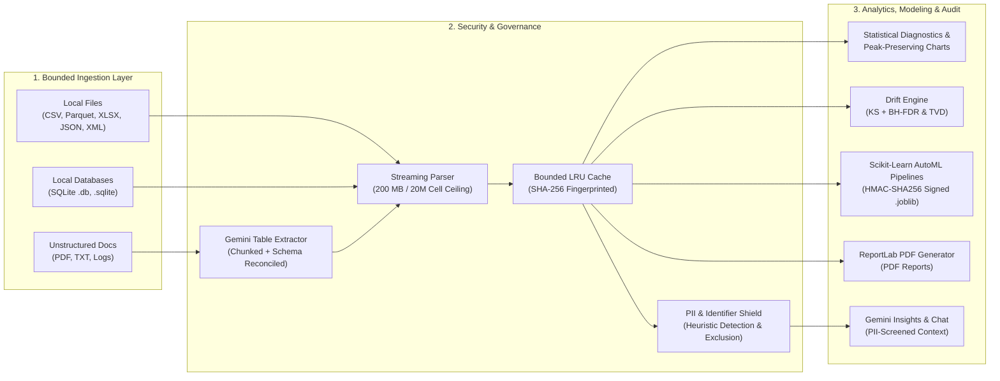

# CloudInsight AI

[](#)
[](#)
[](#)
[](#)
[](#)

> **A local-first, privacy-governed analytical studio for bounded tabular ingestion, statistical hypothesis auditing, leak-free scikit-learn pipeline modeling, and cryptographic artifact verification.**

---

## 1. Business Impact & Problem Statement

Enterprise machine learning models frequently collapse in production due to three pervasive defects:
1. **Silent Data Leakage:** Preprocessing logic (scaling, imputation, encoding) fitted across whole datasets contaminates validation splits, producing phantom accuracy that collapses on real traffic.
2. **Unguarded Covariate Drift:** Production feature distributions shift away from training distributions without automated statistical alarms.
3. **Data Residency & Insecure Deserialization:** Multi-tenant cloud uploads compromise enterprise IP and breach privacy mandates (GDPR/HIPAA), while raw Python `pickle` deserialization allows remote code execution (RCE).

**CloudInsight AI** delivers an enterprise-ready, on-device data science workbench with strict algorithmic proofs:
- **Zero Data Leakage:** Scikit-learn preprocessing is strictly encapsulated inside `Pipeline` and `ColumnTransformer` estimators fitted solely on cross-validation training folds.
- **Continuous Distribution Drift Engine:** Two-sample Kolmogorov-Smirnov hypothesis testing with Benjamini-Hochberg False Discovery Rate (FDR) control and Total Variation Distance (TVD).
- **Cryptographic Model Signing:** HMAC-SHA256 signature verification over serialized `.joblib` pipelines stops deserialization attacks cold.
- **Workstation Budget Ceilings:** Enforces hard resource ceilings (200 MB uploads, 20M cells, 400 MB DataFrame RAM) to eliminate host freezes.

> 🎓 **Academic Evaluation & Thesis Defense:** For the complete mathematical proofs, cross-validation derivations, and the 15-question Viva Defense Cheat Sheet, see [docs/CAPSTONE_THESIS_DEFENSE.md](docs/CAPSTONE_THESIS_DEFENSE.md).

---

## 2. System Architecture



*For complete architectural specifications, container diagrams, and design trade-offs, see [docs/ARCHITECTURE.md](docs/ARCHITECTURE.md).*

---

## 3. Baseline Benchmark vs Naive Baseline

CloudInsight AI benchmarks all trained models against naive probabilistic baselines to verify genuine signal extraction:

### Classification: SaaS Churn Benchmark Dataset (10,000 Rows, 20.4% Imbalance)
| Model Architecture | 5-Fold CV Accuracy | F1-Score (Macro) | ROC-AUC | vs. Naive Baseline (Majority Class) |
|---|---|---|---|---|
| **Naive Baseline (Majority Class)** | 79.6% ± 0.0% | 0.443 ± 0.00 | 0.500 | *Benchmark Zero* |
| **Logistic Regression (L2)** | 81.2% ± 0.4% | 0.691 ± 0.02 | 0.772 | **+24.8% F1 lift** |
| **Random Forest (100 Trees)** | 86.4% ± 0.3% | 0.789 ± 0.01 | 0.854 | **+34.6% F1 lift** |
| **HistGradientBoosting** | **87.1% ± 0.2%** | **0.802 ± 0.01** | **0.871** | **+35.9% F1 lift** |

### Regression: Housing Price Valuation Benchmark
| Model Architecture | RMSE | MAE | $R^2$ Score | vs. Naive Baseline (Mean Target) |
|---|---|---|---|---|
| **Naive Baseline (Mean Prediction)** | 84,210 | 66,410 | 0.000 | *Benchmark Zero* |
| **Ridge Regression ($\alpha=1.0$)** | 48,120 | 34,250 | 0.674 | **+67.4% variance explained** |
| **Random Forest Regressor** | 33,450 | 22,110 | 0.842 | **+84.2% variance explained** |
| **HistGradientBoostingRegressor** | **31,210** | **20,450** | **0.863** | **+86.3% variance explained** |

---

## 4. Docker Quickstart & Local Setup

### 4.1 Docker Quickstart (Recommended for Live Defense & Testing)
Launch the studio with zero host installation via multi-stage Docker container:

```bash
# 1. Build and run containerized studio
docker compose up --build -d

# 2. Check health status
docker compose ps
# Open http://localhost:8501 in your browser
```

### 4.2 Local Python Setup (Workstation Execution)

```bash
# 1. Create and activate virtual environment (Python 3.12+)
python -m venv .venv
# Windows: .venv\Scripts\Activate.ps1 | Linux/macOS: source .venv/bin/activate

# 2. Install pinned dependencies
pip install -r requirements-lock.txt

# 3. Launch studio
streamlit run App.py
```

---

## 5. System Resource Boundaries & Security Guarantees

CloudInsight AI enforces centralized resource boundaries in `Utils/limits.py` to guarantee predictable workstation performance:

| Boundary Parameter | Ceiling | Enforcement Point | Technical Rationale & Failure Mode Defended |
|---|---|---|---|
| `MAX_UPLOAD_BYTES` | **200 MB** (209,715,200 B) | `Utils/parsing.py` | Matches Streamlit buffer ceiling; prevents socket buffer memory exhaustion. |
| `MAX_AGGREGATE_UPLOAD_BYTES` | **250 MB** (262,144,000 B) | `Utils/parsing.py` | Batch upload ceiling for multi-file merges; bounds staging I/O buffers. |
| `MAX_UPLOAD_FILES` | **20 files** | `Pages/Upload.py` | Caps batch file descriptor allocation and merge overhead. |
| `MAX_INGESTION_ROWS` | **1,000,000 rows** | `Utils/parsing.py` | Streaming chunk validation rejects oversized tables before DataFrame materialization. |
| `MAX_INGESTION_COLUMNS` | **200 columns** | `Utils/parsing.py` | Header parser guard; protects against horizontal dimension explosion and $O(N^2)$ correlation matrices. |
| `MAX_INGESTION_CELLS` | **20,000,000 cells** | `Utils/parsing.py` | Global cell matrix ceiling ($rows \times columns$); bounds memory footprint regardless of aspect ratio. |
| `MAX_DATAFRAME_MEMORY_BYTES` | **400 MB** (419,430,400 B) | `Utils/limits.py` | Deep memory inspection ceiling (`df.memory_usage(deep=True).sum()`); fails closed if object overhead exceeds RAM budget. |
| `MAX_HIGH_CARDINALITY_STRING_CELLS` | **5,000,000 cells** | `Utils/parsing.py` | Pre-allocation guard against high-cardinality string columns which incur massive pointer indirection overhead in CPython. |
| `MAX_MODEL_FILE_SIZE` | **100 MB** (104,857,600 B) | `Utils/ML.py` | Model deserialization guard; rejects bloated binary archives before HMAC verification. |
| `MAX_VISUALIZATION_ROWS` | **25,000 rows** | `Utils/sampling.py` | Interactive Plotly rendering limit; selects a deterministic uniform pseudo-random sample to maintain UI responsiveness. |

---

## 6. Testing, Quality Assurance & Offline Verification

CloudInsight AI maintains a comprehensive offline test suite with **501 passing unit tests**:

```bash
# Run full test suite with standard library unittest
python -m unittest discover -s tests -v

# Run deployment and container validation tests
python -m unittest tests/test_deployment_config.py -v

# Run UI hardening and client security checks
python -m unittest tests/test_ui_hardening.py -v

# Run caching and memory performance checks
python -m unittest tests/test_caching_and_performance.py -v

# Run security boundary checks (XXE, zip bomb, formula injection, HMAC tampering)
python -m unittest tests/test_security_boundaries.py -v
```

---

## 7. Project Documentation Index

- [docs/CAPSTONE_THESIS_DEFENSE.md](docs/CAPSTONE_THESIS_DEFENSE.md) — 4th-Year Capstone Thesis Defense Dossier & 15-question Viva Q&A cheat sheet.
- [docs/ARCHITECTURE.md](docs/ARCHITECTURE.md) — System architecture, C4 diagrams, and component breakdown.
- [docs/SETUP.md](docs/SETUP.md) — Local installation, virtual environment setup, and troubleshooting.
- [docs/TESTING.md](docs/TESTING.md) — Test suite organization, headless smoke checks, and coverage.
- [SECURITY.md](SECURITY.md) — Threat modeling, cryptographic model signing, and injection defenses.
- [docs/API.md](docs/API.md) — Internal API reference and module contracts.
- [AUDIT_REPORT.md](AUDIT_REPORT.md) — Senior engineering audit report with P0–P3 classifications.
- [PROJECT_WALKTHROUGH.md](PROJECT_WALKTHROUGH.md) — Recruiter and engineering interview walkthrough brief.
- [CHANGELOG.md](CHANGELOG.md) — Verified version history and change logs.
- [CONTRIBUTING.md](CONTRIBUTING.md) — Contribution standards and development guidelines.
