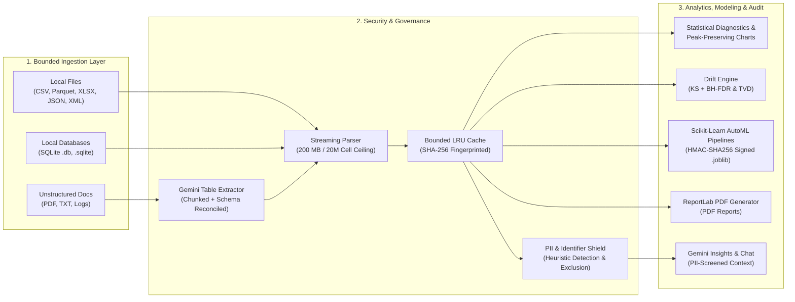

# CloudInsight AI

> **A local-first, privacy-governed analytical workbench for bounded tabular ingestion, statistical hypothesis auditing, scikit-learn pipeline modeling, and cryptographic artifact verification.**

CloudInsight AI is a tabular analytics and machine learning application that runs locally on a workstation (`127.0.0.1:8501`). Designed to eliminate data residency risks associated with multi-tenant SaaS platforms, it enforces hard ingestion ceilings (200 MB files, 20M cells, 400 MB DataFrame RAM), executes distribution drift tests (Kolmogorov-Smirnov with Benjamini-Hochberg FDR control, Total Variation Distance), trains scikit-learn pipelines with 5-fold cross-validation, and secures serialized model artifacts with HMAC-SHA256 cryptographic signatures. External AI interaction via Google Gemini is optional, in-memory only, and guarded by automated PII and identifier screening.

---

## 1. System Architecture



*For complete architectural specifications, container diagrams, and design trade-offs, see [docs/ARCHITECTURE.md](docs/ARCHITECTURE.md).*

---

## 2. Principal Architectural Decisions & Engineering Trade-offs

| # | Architectural Decision | Alternative Considered | Chosen Design & Implementation | Principal Trade-off Analysis |
|---|---|---|---|---|
| **1** | **Local-First Workstation Sovereignty vs. Multi-Tenant SaaS** | Cloud-hosted multi-tenant SaaS (AWS/GCP/Snowflake) with centralized object storage and API proxies. | Single-process local execution bound to `127.0.0.1:8501`. All parsing, caching, and model training occur strictly in workstation RAM and local disk (`Datasets/`, `Models/`). | **Gain:** Eliminates corporate data residency risks (GDPR, HIPAA, SOC 2 Type II); eliminates cloud ingress/egress transit costs and latency; zero persistence of proprietary data on remote servers.<br>**Sacrifice:** Lacks real-time multi-user simultaneous editing and horizontal compute auto-scaling; memory capacity is bounded by local workstation physical RAM. |
| **2** | **Cryptographic HMAC-SHA256 Model Integrity vs. ONNX Runtime vs. Unrestricted Pickle** | (a) Unrestricted `pickle`/`joblib` deserialization.<br>(b) ONNX runtime compilation.<br>(c) Custom JSON weight serializers. | Symmetric HMAC-SHA256 cryptographic signatures stored in `.joblib.sig`. Load routines compute digest and verify against `Models/.model_signing_key` (`0600` permissions, `O_CREAT \| O_EXCL`) before calling `joblib.load()`. | **Gain:** Eliminates arbitrary Python bytecode execution (RCE) via `__reduce__` from untrusted or corrupted model files; avoids heavy C++ runtime dependencies (`onnxruntime`); preserves native Scikit-Learn custom pipeline estimators without translation loss.<br>**Sacrifice:** Assumes single-user OS boundary security; a local root attacker with write permissions to `Models/.model_signing_key` could forge signatures. |
| **3** | **Bounded Streaming Pre-Inspection & Memory Ceilings vs. Unbounded Loading** | Eager in-memory loading via default `pandas.read_csv()` or unbounded Polars lazy evaluation. | Multi-tier bounded streaming pre-inspection: 200 MB file cap, dialect sniffing, pre-parse row/col/cell counting (1M rows, 200 cols, 20M cells), 5M high-cardinality string guard, and deep DataFrame memory ceiling (400 MB). | **Gain:** Eliminates workstation Out-Of-Memory (OOM) operating system freezes; prevents zip bombs and XML entity expansion denial-of-service; deterministic memory budgeting.<br>**Sacrifice:** Rejects arbitrarily massive big-data workloads (>1M rows, >400 MB RAM) that require distributed compute clusters (Spark/Ray). |
| **4** | **Encapsulated Scikit-Learn `Pipeline` & `ColumnTransformer` vs. Ad-Hoc Preprocessing** | Manual preprocessing (scaling, imputation, one-hot encoding) performed across the full dataset prior to train/test splitting. | Strict encapsulation of transformers and estimators within unified Scikit-Learn `Pipeline` and `ColumnTransformer` objects. All transformations are fitted strictly on training folds inside 5-fold cross-validation. | **Gain:** Mathematically guarantees zero data leakage from validation/holdout sets into training folds; produces atomic, self-contained model artifacts that directly score raw un-preprocessed inference data without custom glue code.<br>**Sacrifice:** Higher pipeline serialization complexity; requires rigid column schema alignment during batch inference. |
| **5** | **Ephemeral In-Memory Secret Isolation vs. Disk/Database Vaults** | Local `.env` files, SQLite secret tables, or operating system keyring services. | Pure in-memory credential storage in Streamlit `st.session_state["gemini_secret"]` wrapped in `temporary_secret` context managers that purge secrets upon task completion. Automated PII detection excludes sensitive attributes before prompt dispatch. | **Gain:** Zero secret persistence footprint; API keys never touch persistent media, logs, or backups; leak prevention is absolute across Git workflows.<br>**Sacrifice:** Requires analysts to provide API keys per session; keys do not persist across browser restarts unless cached in active session memory. |

---

## 3. Core Capabilities

### 3.1 Multi-Format Ingestion & Bounded Guards
- Ingests **CSV**, **TSV**, **Excel** (`.xlsx`, `.xls`), **Parquet**, **JSON**, **JSONL**, **XML**, and **HTML tables** locally.
- Unstructured files (**PDF**, text logs, markdown notes) can be passed to Google Gemini for schema extraction into structured CSV tables.
- **Hardened Parsers:** XML external entity (XXE) and DTD injection rejection, ZIP decompression bomb ratio checks (<100x), and strict path traversal containment.

#### System Resource Ceilings & Boundary Guarantees

CloudInsight AI enforces centralized resource boundaries in `Utils/limits.py` to guarantee predictable workstation performance:

| Boundary Parameter | Ceiling | Enforcement Point | Technical Rationale & Failure Mode Defended |
|---|---|---|---|
| `MAX_UPLOAD_BYTES` | **200 MB** (209,715,200 B) | `Utils/parsing.py::read_tabular` | Matches Streamlit buffer ceiling; prevents socket buffer memory exhaustion. |
| `MAX_AGGREGATE_UPLOAD_BYTES` | **250 MB** (262,144,000 B) | `Utils/parsing.py::read_tabular_multi` | Batch upload ceiling for multi-file merges; bounds staging I/O buffers. |
| `MAX_UPLOAD_FILES` | **20 files** | `Pages/Upload.py` | Caps batch file descriptor allocation and merge overhead. |
| `MAX_INGESTION_ROWS` | **1,000,000 rows** | `Utils/parsing.py::read_tabular` | Streaming chunk validation rejects oversized tables before DataFrame materialization. |
| `MAX_INGESTION_COLUMNS` | **200 columns** | `Utils/parsing.py::read_tabular` | Header parser guard; protects against horizontal dimension explosion and $O(N^2)$ correlation matrices. |
| `MAX_INGESTION_CELLS` | **20,000,000 cells** | `Utils/parsing.py::read_tabular` | Global cell matrix ceiling ($rows \times columns$); bounds memory footprint regardless of aspect ratio. |
| `MAX_COMBINED_ROWS` | **1,000,000 rows** | `Utils/parsing.py::read_tabular_multi` | Total row ceiling across concatenated multi-file tabular uploads. |
| `MAX_DATAFRAME_MEMORY_BYTES` | **400 MB** (419,430,400 B) | `Utils/limits.py`, `Utils/parsing.py` | Deep memory inspection ceiling (`df.memory_usage(deep=True).sum()`); fails closed if object overhead exceeds RAM budget. |
| `MAX_HIGH_CARDINALITY_STRING_CELLS` | **5,000,000 cells** | `Utils/parsing.py::read_tabular` | Pre-allocation guard against high-cardinality string columns which incur massive pointer indirection overhead in CPython. |
| `MAX_MODEL_FILE_SIZE` | **100 MB** (104,857,600 B) | `Utils/ML.py::load_trained_model` | Model deserialization guard; rejects bloated binary archives before HMAC verification. |
| `MAX_VISUALIZATION_ROWS` | **25,000 rows** | `Utils/sampling.py::sample_for_visualization` | Interactive Plotly rendering limit; selects a deterministic uniform pseudo-random sample (`df.sample(n=25000, random_state=42)`) when row count exceeds the ceiling to maintain UI responsiveness. |
| `MAX_ANALYSIS_ROWS` | **50,000 rows** | `Utils/compare_logic.py` | Statistical diagnostics and drift computation ceiling (`COMPARE_MAX_ANALYSIS_ROWS`); bounds $O(N \log N)$ sorting and pairwise distance operations. |
| **Decompression Ratio Ceiling** | **100:1 ratio** (100 MB uncompressed) | `Utils/paths.py::_check_zip_bomb` | Pre-extraction inspection of `.xlsx` archive headers to defend against recursive decompression bombs. |

### 3.2 Data Profiling & Hygiene Auditing
- Computes composite **Data Hygiene Index** (completeness and uniqueness metrics).
- Deep RAM footprint measurement, missingness breakdown, and cardinality inspection.
- Interactive slice-and-dice data filtering.

### 3.3 Cleaning & Preprocessing
- Exact row deduplication.
- Statistical imputation: mean, median, zero, mode, or custom value.
- Outlier filtering (IQR and Z-score) and deterministic, collision-safe dataset export.

### 3.4 Feature Engineering Studio
- Numerical scaling: `StandardScaler`, `MinMaxScaler`, `RobustScaler`.
- Categorical encoding: One-Hot encoding (with dummy variable trap prevention) and Ordinal encoding.
- Distribution transforms: Log1p, Square Root, Yeo-Johnson Power Transform.
- Mutual Information non-linear feature screening relative to target variables.
- Interaction feature generation ($A \times B$, $A / B$, $A - B$).

### 3.5 Statistical Diagnostics & Visual Analytics
- Univariate normality screening (D'Agostino-Pearson tests, skewness, kurtosis).
- Correlation matrices (Pearson and Spearman) with significance filtering.
- Variance Inflation Factor (VIF) multicollinearity auditing.
- Group hypothesis testing (One-Way ANOVA F-tests).
- Plotly visualizations: histograms, box/violin plots, scatter/bubble plots with OLS trendlines, sampled time series (25k points), and treemaps.

### 3.6 AutoML Studio & Cryptographic Artifact Verification
- Automatic problem framing (binary/multi-class classification vs. continuous regression).
- Algorithms: Random Forest, Gradient Boosting, Decision Trees, Logistic Regression, Linear Regression, Ridge Regression.
- **Pipeline Encapsulation:** Preprocessing is encapsulated in scikit-learn `Pipeline` and `ColumnTransformer` objects.
- **Validation:** 5-fold cross-validation with standard deviation bounds, compared against dummy baselines. Supports `TimeSeriesSplit` for chronological sequences.
- **HMAC-SHA256 Signing:** Model bundles serialized via `joblib` are signed with HMAC-SHA256. Unsigned or modified bundles are rejected before deserialization to eliminate arbitrary code execution risks.
- **Batch Inference:** Predict on new datasets with automated category drift warnings.

### 3.7 PDF Reporting
- Compiles PDF audit reports via ReportLab.
- Embeds Data Hygiene Index gauges, descriptive statistics, outlier tables, correlation matrices, and optional high-DPI matplotlib figures.
- Reusable report template configurations with overwrite guards.

### 3.8 AI Assistant, Code Execution & Conversational Analysis (Optional)
- Dataset insights and natural language dialogue powered by Google Gemini with local offline fallback.
- **Dual Query Engines:**
  - Online Neuro-Symbolic Engine (`Utils/ai_agent.py::run_neuro_symbolic_query`): Requests Python/pandas snippets from Gemini and executes them inside an AST-filtered scope (`Utils/ai_sandbox.py::execute_sandboxed_code`).
  - Air-Gapped Local Deterministic Engine (`Utils/ai_agent.py::run_local_deterministic_query`): Operates offline without external network calls, computing descriptive statistics, correlation matrices, and distributions via local pandas/numpy algorithms.
- **AST Code Execution Guardrail & Limitations:**
  - AST filtering before `exec()` inspects code syntax trees to reject dynamic imports (`import`, `__import__`), dunder attribute access (`__`), and banned functions (`eval`, `exec`, `open`, `compile`, `os`, `sys`).
  - **Important:** AST static filtering is a best-effort guardrail, not an operating system isolation boundary or secure sandbox. It does not stop CPU exhaustion (infinite loops), excessive memory allocation, algorithmic complexity denial of service, thread blocking, or object traversal through exposed DataFrame/Series methods.
- **PII and Identifier Screening:** Heuristically detects emails, phone numbers, credit cards (Luhn valid), IBANs, and identifiers (`customer_id`, `ssn`, `uuid`), auto-excluding them from AI prompt context.
- **Credential Lifecycle:** In-memory API key handling via `st.session_state` and `temporary_secret` context managers; keys do not touch disk or logs.

---

## 4. Application Navigation Overview

| Navigation Group | Page | Purpose |
|---|---|---|
| **Overview** | Workspace Home | Workbench overview, architecture, and synthetic benchmark loader |
| **Overview** | Data Health & Profiler | Data Hygiene Index gauge, cardinality inspector, null diagnostics |
| **Data Management** | Data Hub & Ingest | Multi-format file upload, text paste, catalog management |
| **Data Management** | Data Cleaning & Imputation | Deduplication, statistical imputation, and sanitized export |
| **Data Management** | Feature Engineering Studio | Scaling, categorical encoding, transforms, mutual information |
| **Exploratory Analysis**| Statistical Diagnostics | Normality tests, correlation matrices, VIF multicollinearity, ANOVA |
| **Exploratory Analysis**| Interactive Visual Analytics | Plotly distribution, relational, categorical, and heatmap charts |
| **Machine Learning** | Model Studio & Training | Classification/regression pipelines, 5-fold CV, model signing |
| **Machine Learning** | Batch Scoring & Simulation | HMAC-signed model loading, batch inference, drift detection |
| **AI & Gemini Assistant**| AI File Converter | Extract structured CSV tables from unstructured documents/logs |
| **AI & Gemini Assistant**| AI Summary & Insights | Statistical summaries and natural language executive diagnostics |
| **AI & Gemini Assistant**| Ask AI (Chat) | Conversational dataset Q&A with PII-screened context boundaries |
| **Audit & Reports** | Dataset Drift & Compare | Kolmogorov-Smirnov test (BH-FDR corrected) & TVD drift analysis |
| **Audit & Reports** | Data Science Audit Report | PDF audit report compilation and templates |

---

## 5. Quick Start & Setup

### 5.1 Prerequisites
- Python **3.12** or **3.13** (64-bit)
- Modern web browser (Chrome, Edge, Firefox, Safari)

### 5.2 Installation

```bash
# 1. Create virtual environment
python -m venv venv

# 2. Activate environment
# Windows PowerShell:
.\venv\Scripts\Activate.ps1
# macOS / Linux:
source venv/bin/activate

# 3. Install dependencies (lockfile recommended for exact reproducibility)
pip install -r requirements-lock.txt
```

### 5.3 Launch Application

```bash
python -m streamlit run App.py
```
Open `http://localhost:8501` in your browser.

*For complete setup options, Windows launch scripts, and environment troubleshooting, see [docs/SETUP.md](docs/SETUP.md).*

---

## 6. Testing, Quality Assurance & Offline Verification

CloudInsight AI maintains a test suite executed offline without requiring external network connectivity or live AI API keys (external endpoints are mocked at the boundary):

```bash
# Run full test suite with standard library unittest
python -m unittest discover -s tests -v

# Run test suite with coverage reporting
coverage run -m unittest discover -s tests
coverage report --show-missing

# Run headless Streamlit AppTest smoke checks
python -m unittest tests/test_page_smoke.py -v

# Run security boundary checks (XXE, zip decompression, formula injection, HMAC tampering)
python -m unittest tests/test_security_boundaries.py -v

# Run statistical diagnostics, drift tests, and model pipeline tests
python -m unittest tests/test_ml_and_drift.py -v
```

*For test architecture, coverage configs, and mock boundaries, see [docs/TESTING.md](docs/TESTING.md).*

---

## 7. Security & Privacy Posture

- **OWASP ASVS & NIST SP 800-218 Alignment:** Architectural controls mapped directly to OWASP ASVS v5.0.0 and NIST Secure Software Development Framework (SSDF v1.1).
- **No Disk Secrets:** API keys reside in `st.session_state` RAM only; purged by `temporary_secret` context managers upon task completion. Never touch persistent media, logs, or backups.
- **Model Tamper Evidence:** HMAC-SHA256 model signing prevents arbitrary pickle deserialization of untrusted files.
- **Path Isolation:** Filesystem operations are strictly bound to `Datasets/`, `Models/`, and `Reports/` with traversal token rejection.
- **Injection Defenses:** Hardened against XXE, zip decompression bombs, and CSV formula injection.
- **Privacy Shield:** PII detection flags sensitive columns before transmission to external AI services.

*For threat models, attack payloads, and OWASP ASVS verification details, see [SECURITY.md](SECURITY.md).*

---

## 8. Project Documentation Index

- [docs/ARCHITECTURE.md](docs/ARCHITECTURE.md) — System architecture, C4 diagrams, and component breakdown.
- [docs/SETUP.md](docs/SETUP.md) — Local installation, virtual environment setup, and troubleshooting.
- [docs/TESTING.md](docs/TESTING.md) — Test suite organization, headless smoke checks, and coverage.
- [SECURITY.md](SECURITY.md) — Threat modeling, cryptographic model signing, and injection defenses.
- [docs/API.md](docs/API.md) — Internal API reference and module contracts.
- [AUDIT_REPORT.md](AUDIT_REPORT.md) — Senior engineering audit report with P0–P3 classifications.
- [PROJECT_WALKTHROUGH.md](PROJECT_WALKTHROUGH.md) — Recruiter and engineering interview walkthrough brief.
- [CHANGELOG.md](CHANGELOG.md) — Verified version history and change logs.
- [CONTRIBUTING.md](CONTRIBUTING.md) — Contribution standards and development guidelines.
