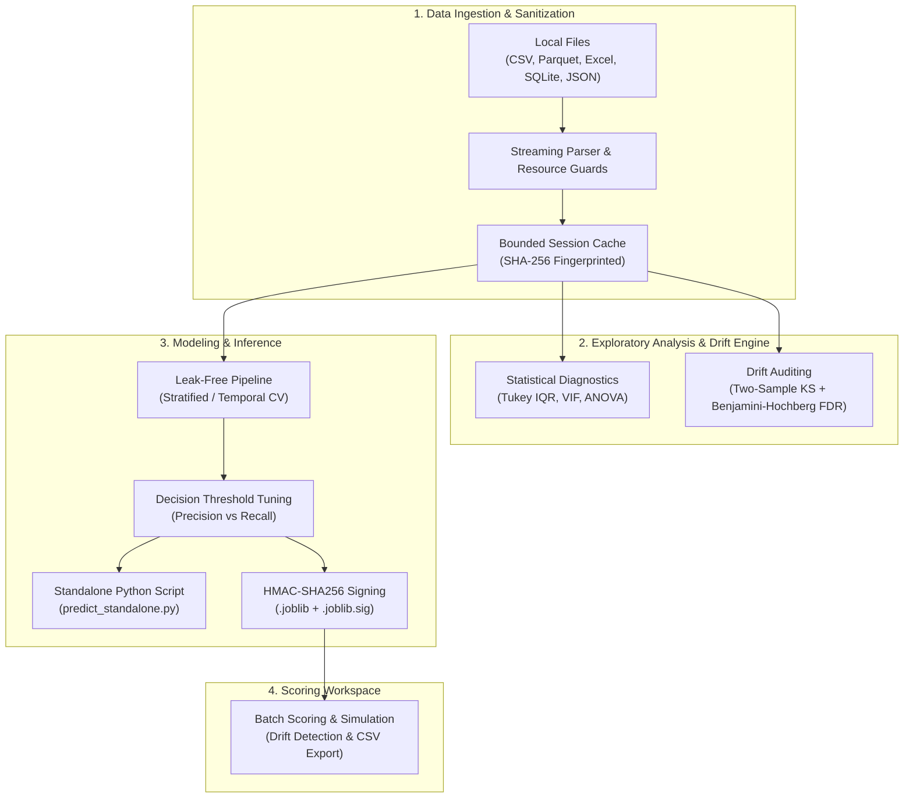

# TabuLens

**Tabular Data Exploration, Drift Auditing & Leak-Free Modeling**

TabuLens is a local-first tabular data science studio built with Python, Streamlit, and Scikit-Learn. It provides an end-to-end workflow for dataset ingestion, statistical exploratory data analysis, dataset drift auditing, leak-free machine learning training with decision threshold tuning, and standalone Python inference export.

Designed and developed as a 4th-year Computer Science / Data Science capstone project.

---

## Key Features

1. **Local-First Ingestion & Governance**
   - Ingests CSV, TSV, Parquet, Excel (`.xlsx`, `.xls`), SQLite databases, and structured JSON.
   - Resource-bounded safety checks: protects workstation memory with 200 MB file limits, 20M cell limits, and automatic row sampling for large interactive charts.
   - PII and identifier screening: automatically detects camelCase identifiers, SSNs, and phone number columns to prevent feature leakage.

2. **Exploratory Data Analysis & Statistical Diagnostics**
   - Univariate summaries, distribution skewness, kurtosis, and D'Agostino-Pearson normality tests.
   - Tukey's IQR fences ($Q_1 \pm k \times \text{IQR}$) and parametric Z-score outlier detection.
   - Variance Inflation Factor (VIF) matrix to diagnose severe multicollinearity ($\text{VIF} \ge 10$).
   - One-Way ANOVA hypothesis testing across categorical groups.

3. **Dataset Drift Auditing**
   - Two-sample Kolmogorov-Smirnov test ($D = \sup_x |F_1(x) - F_2(x)|$) for continuous numerical features.
   - Total Variation Distance (TVD) and Chi-square contingency testing for categorical distributions.
   - **Benjamini-Hochberg (BH)** procedure controlling the False Discovery Rate (FDR at $Q = 0.05$) across multiple feature comparisons.

4. **Leak-Free Scikit-Learn Modeling**
   - Encapsulates imputation, one-hot encoding, and standard scaling strictly inside `Pipeline` and `ColumnTransformer` estimators.
   - Preprocessing is fitted solely on training folds, preventing data leakage into holdout test sets.
   - Every model is benchmarked against a naive majority-class `DummyClassifier` or mean `DummyRegressor` to prove genuine feature learning.

5. **Decision Threshold Optimization**
   - Interactive probability cutoff slider ($\theta \in [0.05, 0.95]$) for binary classification.
   - Recomputes precision, recall, F1, and confusion matrix in $O(1)$ without refitting the model.
   - Persists calibrated thresholds into saved model bundles.

6. **Standalone Python Inference Export**
   - Generates a self-contained, lightweight Python script (`predict_standalone.py`) to run batch predictions on CSV files without requiring Streamlit or a browser UI.
   - Includes CLI arguments (`--input`, `--output`, `--threshold`).

7. **Cryptographic Model Artifact Signing**
   - Serialized `.joblib` bundles are signed with host-bound HMAC-SHA256 digests (`.joblib.sig`).
   - Verifies integrity in memory prior to deserialization to guard against untrusted pickle execution.

---

## System Architecture



---

## Mathematical & Statistical Foundations

For comprehensive mathematical formulations, proofs, and derivations of the algorithms implemented in TabuLens (including Kolmogorov-Smirnov test statistics, Benjamini-Hochberg correction, VIF equations, and pipeline fold isolation), refer to:

- [docs/METHODOLOGY.md](docs/METHODOLOGY.md)

---

## Quickstart

### Prerequisites
- Python 3.11 or 3.12
- Git

### 1. Local Setup

```bash
# Clone the repository
git clone https://github.com/your-username/TabuLens.git
cd TabuLens

# Create and activate a virtual environment
python -m venv .venv

# On Linux/macOS:
source .venv/bin/activate
# On Windows PowerShell:
.venv\Scripts\Activate.ps1

# Install dependencies
pip install --upgrade pip
pip install -r requirements.txt

# Run the TabuLens application
streamlit run app.py
```

The application will be accessible at `http://localhost:8501`.

---

### 2. Docker Quickstart (2-Stage Build)

TabuLens includes a minimal two-stage Dockerfile running as an unprivileged system user (`appuser`):

```bash
# Build and run using Docker Compose
docker compose up --build
```

Access the studio at `http://localhost:8501`.

---

### 3. Pipeline & Verification Runner

To verify environmental compatibility, cryptographic invariants, and execute the full test suite:

```bash
# Run full verification and unit tests
python scripts/verify_pipeline.py

# Or run configuration and cryptographic checks only
python scripts/verify_pipeline.py --check-only
```

---

## Repository Structure

```text
TabuLens/
├── app.py                     # Streamlit application entrypoint & navigation
├── pages/                     # Dedicated studio workflows
│   ├── upload.py              # Ingestion, schema validation & dataset catalog
│   ├── eda.py                 # Statistical diagnostics, Tukey IQR & VIF
│   ├── compare.py             # KS-drift engine with Benjamini-Hochberg FDR
│   ├── visualization.py       # Peak-preserving interactive charts
│   ├── cleaning.py            # Deduplication, outlier clipping & imputation
│   ├── feature_engineering.py # Polynomial, log transforms & binning
│   ├── ml.py                  # Model training, baseline benchmarks & threshold tuning
│   ├── predict.py             # Batch inference scoring & simulation
│   ├── dashboard.py           # Multi-metric workspace overview
│   └── report.py              # Tabular audit summary and PDF export
├── utils/                     # Decoupled computational & security utilities
│   ├── compare_logic.py       # KS-test & Benjamini-Hochberg algorithms
│   ├── eda_logic.py           # Tukey IQR, Z-score, VIF & ANOVA calculations
│   ├── ml.py                  # Scikit-learn pipelines, thresholding & HMAC signing
│   ├── paths.py               # Path containment & tabular ingestion parsers
│   ├── preprocessing.py       # Missing value imputation & feature encoders
│   └── theme.py               # Lightweight CSS design tokens & Plotly themes
├── docs/                      # Documentation
│   └── METHODOLOGY.md         # Detailed mathematical foundations
├── scripts/                   # Automation & operational tools
│   ├── verify_pipeline.py     # End-to-end pipeline verification runner
│   └── healthcheck.py         # Container healthcheck probe
├── tests/                     # Unit, integration, and headless regression test suite
├── Dockerfile                 # 2-stage unprivileged container specification
├── docker-compose.yml         # Container composition manifest
└── requirements.txt           # Clean production dependencies
```

---

## License

This project is licensed under the MIT License. See [LICENSE](LICENSE) for details.
