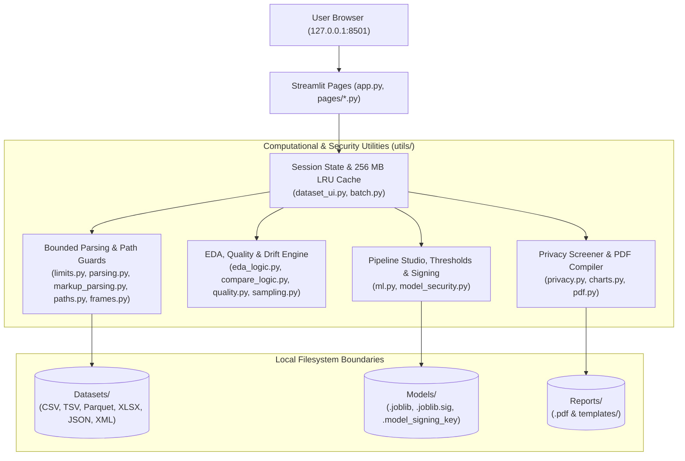

# TabuLens

TabuLens is a local-first Python and Streamlit workbench for tabular data inspection, cleaning, exploratory statistics, distribution drift auditing, supervised scikit-learn modeling, and standalone batch inference.

All parsing, statistical testing, training, model signing, and PDF reporting run locally with zero external API keys or network calls.

---

## What It Does

TabuLens organizes the tabular analytics workflow across eleven views (`app.py` and `pages/*.py`):

| Area | Page | Capabilities |
|---|---|---|
| Overview | `app.py` | Workspace navigation and deterministic synthetic benchmarks (`saas_customers_q1.csv`, `saas_customers_q2_drifted.csv`, `housing_market_prices.csv`). |
| Overview | `pages/dashboard.py` | Composite Data Hygiene Index (`(completeness + uniqueness) / 2`), per-column null/cardinality profiling, interactive row filtering, and distribution previews. |
| Data Management | `pages/upload.py` | Multi-file upload and merge, SQLite table/SQL extraction, raw delimited text paste, and local `Datasets/` catalog management. |
| Data Management | `pages/cleaning.py` | Exact deduplication, numeric (`mean`/`median`/`zero`) and categorical (`mode`/`Unknown`) imputation, complete-case row removal, and sanitized CSV/Parquet export. |
| Data Management | `pages/feature_engineering.py` | Scaling (`StandardScaler`, `MinMaxScaler`, `RobustScaler`), one-hot/ordinal encoding, `log1p`/`sqrt`/Yeo-Johnson transforms, Mutual Information screening, and pairwise interactions. |
| Exploratory Analysis | `pages/eda.py` | Univariate summary stats, D'Agostino-Pearson normality checks, Pearson/Spearman correlations, Variance Inflation Factor (VIF), Tukey IQR / Z-score outliers, and one-way ANOVA. |
| Exploratory Analysis | `pages/visualization.py` | Interactive Plotly histograms, box/violin plots, scatter plots with optional OLS trendlines, min-max envelope decimated line charts, bar/pie/donut/treemaps, and correlation heatmaps. |
| Exploratory Analysis | `pages/compare.py` | Schema diff, missingness/mean/dispersion shifts, two-sample Kolmogorov-Smirnov tests with Benjamini-Hochberg FDR control ($Q = 0.05$), and categorical Total Variation Distance ($\text{TVD} \ge 0.20$). |
| Machine Learning | `pages/ml.py` | Classification and regression with `ColumnTransformer` + `Pipeline` isolation, 5-fold CV (`StratifiedKFold`, `KFold`, or `TimeSeriesSplit`), `DummyClassifier`/`DummyRegressor` baselines, binary threshold tuning, and HMAC-signed model persistence. |
| Machine Learning | `pages/predict.py` | Verified `.joblib` bundle inspection, training-data overlap checks via SHA-256 fingerprints, batch scoring with unseen-category drift detection, and standalone CLI script export. |
| Audit & Reports | `pages/report.py` | ReportLab PDF audit report compilation with PII/column redaction, Matplotlib charts, batch multi-dataset export, and JSON template presets. |

---

## System Architecture



### Key Technical Mechanics

- **Bounded ingestion (`utils/limits.py`, `utils/parsing.py`, `utils/paths.py`):** Enforces 200 MB per-file limits (250 MB / 20 files per batch), 1,000,000 rows, 200 columns, 20,000,000 cells, 400 MB deep DataFrame RAM, 5,000,000 high-cardinality string cell guards, `.xlsx` ZIP bomb inspection, XML `<!DOCTYPE`/`<!ENTITY` rejection, path containment inside `Datasets/`, and CSV formula sanitization (`utils/frames.py`).
- **Leak-free modeling pipelines (`utils/ml.py`):** Splits train/holdout first, encapsulates imputation, scaling, and one-hot encoding inside scikit-learn `Pipeline` + `ColumnTransformer` objects fitted strictly on training folds, benchmarks every run against `DummyClassifier` or `DummyRegressor`, and calibrates binary thresholds ($\theta \in [0.05, 0.95]$) using training out-of-fold probabilities.
- **Cryptographic model loading (`utils/model_security.py`):** Signs serialized `.joblib` bundles with a host-local 32-byte key (`Models/.model_signing_key`, `0o600`) and verifies the `.joblib.sig` HMAC-SHA256 digest in memory before `joblib.load()` runs.
- **Standalone inference CLI (`predict_<model>.py`):** Exports a self-contained Python script (`--input`, `--output`, `--threshold`, `--key-path`, `--allow-unverified-model`) that checks the HMAC signature, validates feature columns, applies the saved cutoff, and writes sanitized CSV predictions without Streamlit.

For detailed rationale behind these trade-offs, see [Architecture Decision Records](docs/decisions/README.md) and [docs/ARCHITECTURE.md](docs/ARCHITECTURE.md). For statistical equations and threshold rules, see [docs/METHODOLOGY.md](docs/METHODOLOGY.md).

---

## Tech Stack

- **Runtime & Packaging:** Python `>=3.11` (CI matrix tests `3.11` and `3.12`), `pyproject.toml`, `requirements.txt`, `requirements-lock.txt`
- **UI & Visualization:** `streamlit>=1.52.0`, `plotly>=5.18.0`
- **Data Processing & Formats:** `pandas>=2.0.0`, `numpy>=1.24.0`, `pyarrow>=14.0.0`, `openpyxl>=3.1.0`, `xlrd>=2.0.1`, stdlib `sqlite3` / `xml.etree.ElementTree` / `html.parser`
- **Statistics & ML:** `scikit-learn>=1.3.0`, `scipy`, `statsmodels>=0.14.0`, `joblib`
- **PDF Reporting:** `reportlab>=4.0.0`, `matplotlib>=3.7.0`
- **Quality & Containerization:** `ruff`, `unittest`, `coverage`, multi-stage `Dockerfile`, `docker-compose.yml`, GitHub Actions (`.github/workflows/ci.yml`)

---

## Quick Start

### Local Setup

```bash
git clone https://github.com/Srikiran22/CloudlnsightAl.git
cd CloudlnsightAl

python -m venv .venv
# Linux / macOS:
source .venv/bin/activate
# Windows PowerShell:
.\.venv\Scripts\Activate.ps1

pip install --upgrade pip
pip install -r requirements.txt

streamlit run app.py
```

Open `http://127.0.0.1:8501` in your browser and click **Load sample datasets (SaaS Churn, Drift & Housing)** on the home page to populate synthetic datasets immediately.

### Docker Quickstart

TabuLens includes a two-stage `Dockerfile` running as non-root `appuser` with volume mounts for `Datasets/`, `Models/`, and `Reports/`:

```bash
docker compose up --build
```

The app is bound to `http://127.0.0.1:8501` and probed by `scripts/healthcheck.py`.

---

## Commands

| Command | Description |
|---|---|
| `streamlit run app.py` | Start the TabuLens web interface locally |
| `python scripts/verify_pipeline.py` | Run static environment/HMAC checks and the full `unittest` suite |
| `python scripts/verify_pipeline.py --check-only` | Run static layout, dependency, and HMAC tamper-rejection checks only |
| `python -m unittest discover -s tests -v` | Run all unit, security-boundary, and headless `AppTest` checks |
| `ruff check .` | Run linter checks configured in `pyproject.toml` |
| `docker compose up --build` | Build and run the two-stage container locally |

---

## Repository Structure

```text
CloudlnsightAl/
├── app.py                      # Streamlit entrypoint, navigation & synthetic benchmark seeding
├── pages/                      # 10 multi-page Streamlit workflow views
├── utils/                      # Bounded ingestion, EDA, drift, ML pipelines, HMAC signing & PDF export
├── docs/
│   ├── ARCHITECTURE.md         # Component breakdown and filesystem trust boundaries
│   ├── METHODOLOGY.md          # Statistical tests, drift FDR, VIF, outliers & ML validation math
│   ├── API.md                  # Public utility function signatures and contracts
│   ├── SETUP.md                # Workstation & Docker installation and troubleshooting
│   ├── TESTING.md              # Test suite organization and execution commands
│   └── decisions/              # Architecture Decision Records (ADR-001 through ADR-005)
├── scripts/
│   ├── verify_pipeline.py      # Environment, HMAC invariant & test runner CLI
│   └── healthcheck.py          # Container HTTP probe on /_stcore/health
├── tests/                      # 19 unit, security-boundary, and AppTest modules
├── .github/workflows/ci.yml    # Ruff lint + unittest coverage on Python 3.11 & 3.12
├── Dockerfile                  # Two-stage non-root runtime image
├── docker-compose.yml          # Local service definition and volume mounts
├── pyproject.toml              # Package metadata, Ruff config, and coverage settings
├── requirements.txt            # Runtime dependencies
└── requirements-lock.txt       # Compiled dependency lockfile
```

---

## Scope & Known Limitations

- **Workstation scale:** Hard caps in `utils/limits.py` (1M rows, 200 columns, 20M cells, 400 MB DataFrame RAM) protect single-machine memory rather than scaling out to distributed clusters.
- **Drift vs. concept shift:** `pages/compare.py` measures marginal feature shift $P(X)$ and schema/missingness changes via KS + BH-FDR and categorical TVD; it does not evaluate labelled concept drift $P(Y \mid X)$ or prove accuracy degradation without ground-truth outcomes.
- **Interactive feature engineering:** Transformations applied in `pages/feature_engineering.py` operate on the active DataFrame as a whole. For leakage-free model evaluation, rely on the preprocessing steps inside `Model Studio & Training`'s `Pipeline`.
- **Time-series threshold calibration:** When `TimeSeriesSplit` is selected in `pages/ml.py`, `cross_val_predict` cannot produce out-of-fold predictions for the initial training block; `utils/ml.py` catches this and falls back rather than failing training.
- **Local HMAC trust model:** `.joblib.sig` verification guards against accidental corruption and unsigned third-party `.joblib` files on the local machine assuming `Models/.model_signing_key` (`0o600`) remains private to the host user.
- **Heuristic PII screening:** `utils/privacy.py` flags likely identifiers, emails, phone numbers, Luhn-valid cards, IBANs, and token patterns from column names and a 100-row sample; it is an advisory aid, not formal anonymization or compliance certification.

---

## Documentation & Governance

- [Architecture Overview](docs/ARCHITECTURE.md)
- [Statistical & ML Methodology](docs/METHODOLOGY.md)
- [Utility API Reference](docs/API.md)
- [Architecture Decision Records](docs/decisions/README.md)
- [Setup & Troubleshooting](docs/SETUP.md)
- [Testing Strategy](docs/TESTING.md)
- [Security Policy](SECURITY.md)
- [Contributing Guide](CONTRIBUTING.md)
- [Changelog](CHANGELOG.md)
- [License (MIT)](LICENSE)
