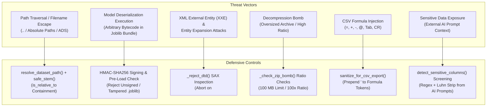

# Security Policy

## 1. Supported Versions (Proposal)

| Version | Status |
| ------- | ------ |
| 2.2.x | Supported |
| < 2.2 | Unsupported |

*Note: Version support status is a proposed policy pending formal release tagging.*

## 2. Reporting a Vulnerability

If you discover a security vulnerability in CloudInsight AI:
1. Do not open a public issue.
2. Report the vulnerability privately to maintainers or via repository security advisories.
3. Include reproduction steps, environment details, and affected version.
4. You will receive an initial response within 48 hours.

---

## 3. Threat Model and Trust Assumptions

### 3.1 Operating Scope
- **Deployment Model:** Single-user analytical desktop application executed locally on `127.0.0.1:8501`.
- **Primary Trust Boundary:** All incoming files (CSV, Parquet, Excel, XML, JSON, PDF, and serialized `.joblib` model bundles) originate from untrusted sources and are validated before parsing or execution.
- **User Context:** The application process runs under local operating system user permissions and relies on OS-level access control to isolate processes and storage.

### 3.2 Threat Vectors and Defense Architecture

---

## 4. Standards Alignment and Defense Matrix

Controls are mapped against **OWASP ASVS v5.0.0** and **NIST SP 800-218 (SSDF v1.1)**:

| Threat Vector | Standards Mapping | Input Classes Defended | Enforcing Function | Covering Tests |
|---|---|---|---|---|
| **Path Traversal & Device Name Escapes** | ASVS 12.1.1 NIST PW.1.1 | Traversal tokens (`..`), leading slashes, absolute drive letters, Windows Alternate Data Streams (`:`), and Windows reserved device stems (`CON`, `PRN`, `AUX`, `NUL`, `COM1-9`, `LPT1-9`). | [`Utils/paths.py::resolve_dataset_path`](Utils/paths.py) [`Utils/paths.py::safe_stem`](Utils/paths.py) | - [`test_path_traversal_rejected`](tests/test_security_boundaries.py) - [`test_resolve_dataset_path_rejects_alternate_data_streams`](tests/test_security_boundaries.py) - [`test_resolve_dataset_path_rejects_drive_relative`](tests/test_security_boundaries.py) - [`test_safe_stem_windows_reserved_and_length`](tests/test_security_boundaries.py) - [`test_get_unique_filename_sanitizes_windows_reserved_device_stems`](tests/test_security_boundaries.py) |
| **Pickle Deserialization Code Execution** | ASVS 5.5.1, 6.2.1 NIST PW.1.1 | Unsigned joblib bundles, tampered binary payload bytes, forged signature files, or mismatched model file names. | [`Utils/ML.py::load_trained_model`](Utils/ML.py) [`Utils/ML.py::save_trained_model`](Utils/ML.py) | - [`test_malicious_pickle_blocked_before_load`](tests/test_security_boundaries.py) - [`test_unsigned_model_rejected`](tests/test_security_boundaries.py) - [`test_tampered_signature_hash_rejected`](tests/test_security_boundaries.py) - [`test_mismatched_model_file_target_signature_rejected`](tests/test_security_boundaries.py) |
| **XML External Entity (XXE) & DTD Injection** | ASVS 5.2.2 NIST PW.4.1 | XML files containing `<!DOCTYPE` or `<!ENTITY` declarations. | [`Utils/paths.py::_reject_dtd`](Utils/paths.py) | - [`test_dtd_rejection_without_materializing_full_stream`](tests/test_ml_and_drift.py) - [`test_dtd_padded_past_any_fixed_inspection_window_is_rejected`](tests/test_core_pipeline.py) |
| **ZIP Decompression Bomb** | ASVS 12.2.1 NIST PW.1.1 | ZIP or XLSX archives exceeding 100 MB uncompressed or with expansion ratios exceeding 100:1. | [`Utils/paths.py::_check_zip_bomb`](Utils/paths.py) | - [`test_excel_zip_bomb_check_catches_suspicious_archive`](tests/test_ingestion_parsers.py) |
| **CSV Formula Injection** | ASVS 5.2.4 NIST PW.4.1 | Cells starting with formula tokens (`=`, `+`, `-`, `@`, `\t`, `\r`) or leading whitespace before formula triggers. | [`Utils/frames.py::sanitize_for_csv_export`](Utils/frames.py) | - [`test_formula_sanitization_boundary`](tests/test_security_boundaries.py) - [`test_formula_injection_strips_leading_whitespace_triggers`](tests/test_security_boundaries.py) - [`test_save_and_activate_dataset_formula_sanitization`](tests/test_security_boundaries.py) |
| **Sensitive Data Exposure** | ASVS 6.4.1, 8.3.1 NIST PS.1.1 | Column names matching identifier keywords and data matching patterns for emails, phone numbers, IBANs, or Luhn-valid credit card numbers. | [`Utils/privacy.py::detect_sensitive_columns`](Utils/privacy.py) [`Utils/privacy.py::apply_exclusions`](Utils/privacy.py) | - [`test_secret_named_columns_flagged_by_name`](tests/test_core_pipeline.py) - [`test_luhn_valid_card_flagged_but_random_digits_not`](tests/test_core_pipeline.py) - [`test_token_boundary_detects_real_sensitive_names`](tests/test_ingestion_parsers.py) |
| **Resource Exhaustion** | ASVS 5.1.1 NIST PW.1.1 | Uploads exceeding 200 MB, tabular inputs exceeding 1,000,000 rows, 200 columns, or 20,000,000 cells, and DataFrames exceeding 400 MB. | [`Utils/parsing.py::read_tabular`](Utils/parsing.py) [`Utils/limits.py`](Utils/limits.py) | - [`test_cell_budget_enforced`](tests/test_security_boundaries.py) - [`test_chunked_ingestion_streaming_row_cell_limits`](tests/test_security_boundaries.py) - [`test_read_tabular_enforces_size_limit_on_raw_file_handles`](tests/test_security_boundaries.py) |

---

## 5. Implementation Details

### 5.1 Model Deserialization Boundary
`joblib` bundles serialize Python objects. To prevent arbitrary code execution:
- Loaded models must reside within `MODELS_DIR` (path traversal outside this directory is rejected).
- Models require an HMAC-SHA256 signature stored in a companion `.joblib.sig` file, verified before deserialization.
- The signing key is generated on first use (or reused if already present) at `Models/.model_signing_key` using 32 cryptographically secure random bytes (`secrets.token_bytes(32)`) via `os.open` with `os.O_CREAT | os.O_EXCL` flags and file mode `0o600`.
- Unsigned, tampered, or relocated model files are rejected prior to `joblib.load()`.
- An explicit `trusted=True` override exists solely for test fixtures and logs warning messages when invoked.

#### Symmetric HMAC-SHA256 Design Rationale
- **Single-Host Boundary:** In a local workstation analytics application, model training and model scoring occur within the same security domain on the same machine.
- **Zero External Dependencies:** HMAC-SHA256 is implemented using standard library `hashlib` and `hmac` with constant-time equality checks (`hmac.compare_digest`).
- **Trust Boundary Clarification:** Bundles not signed by this installation's key are rejected. HMAC signing detects file corruption and accidental modification, but does not protect against a local user who already has write access to the signing key on the local filesystem.

### 5.2 Ingestion Resource Limits
To prevent denial of service and memory exhaustion:
- File size limit: 200 MB (`MAX_UPLOAD_BYTES`).
- Batch upload ceiling: 250 MB (`MAX_AGGREGATE_UPLOAD_BYTES`, max 20 files).
- Cell budget: 20,000,000 cells (`MAX_INGESTION_CELLS` = rows x columns).
- Dimensional bounds: 1,000,000 rows and 200 columns.
- DataFrame memory budget: 400 MB (`MAX_DATAFRAME_MEMORY_BYTES`).
- High-cardinality string guard: 5,000,000 cells (`MAX_HIGH_CARDINALITY_STRING_CELLS`).

### 5.3 Formula Injection and Export Handling
- Internal working datasets stored in `Datasets/` maintain exact raw values to prevent numerical truncation or distortion during data analysis.
- File exports destined for external spreadsheet tools (`CSV` and `Excel`) pass through `sanitize_for_csv_export()`, prepending a single quote (`'`) to cells starting with formula tokens (`=`, `+`, `-`, `@`, `\t`, `\r`).

### 5.4 Filesystem and Path Containment
- User-supplied filenames are sanitized through `safe_stem()`.
- Windows reserved device stems (`CON`, `PRN`, `AUX`, `NUL`, `COM1-9`, `LPT1-9`) are replaced with safe fallback strings.
- Filename stems are bounded to 100 characters.
- Path traversal sequences (`..`, absolute drive letters, leading slashes, Windows ADS colons) are rejected.

### 5.5 Credential Handling and AI Context Boundary
- API keys are stored in `st.session_state` in memory only. Keys are not written to disk, databases, environment files, or logs.
- The `temporary_secret` context manager purges key values upon task completion unless the user enables session retention.
- Prompts sent to external AI services pass through `detect_sensitive_columns()` to identify email addresses, phone numbers, credit cards (Luhn checked), IBANs, and identifier columns (`id`, `uuid`, `pk`). Detected columns are excluded from context by default.

---

## 6. Residual Risks and Operational Constraints

1. **Local System Access:** An attacker with local filesystem write access to `Models/.model_signing_key` can generate valid signatures. Security relies on operating system user account separation.
2. **Network Exposure:** Running `streamlit run App.py` binds to `127.0.0.1` by default. Exposing the service over a local network requires an external reverse proxy with TLS termination and user authentication.
3. **Scanned Documents:** The PDF parser (`pypdf`) extracts digital text streams. Bitmapped image scans require OCR preprocessing prior to ingestion.
4. **AI Code Execution Guardrail:** AST inspection in `Utils/ai_sandbox.py` is a best-effort syntax check before `exec()`, not a process isolation boundary. It does not stop CPU exhaustion, memory allocation exhaustion, or thread blocking.
