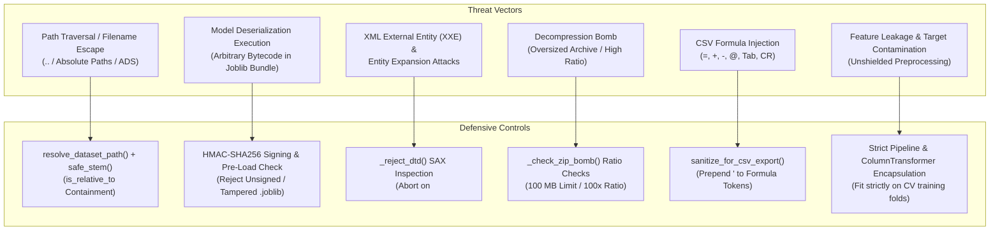

# Security Policy

## 1. Supported Versions

| Version | Status |
| ------- | ------ |
| 1.0.x   | Supported |

---

## 2. Reporting a Vulnerability

If you discover a security vulnerability in TabuLens:
1. Do not open a public issue.
2. Report the vulnerability privately to project maintainers.
3. Include reproduction steps, environment details, and affected version.

---

## 3. Threat Model and Trust Assumptions

### 3.1 Operating Scope
- **Deployment Model:** Single-user analytical desktop application executed locally on `127.0.0.1:8501` or via Docker container.
- **Primary Trust Boundary:** All incoming files (CSV, Parquet, Excel, XML, JSON, SQLite, and serialized `.joblib` model bundles) originate from untrusted sources and are validated before parsing or execution.
- **User Context:** The application process runs under local operating system user permissions (or unprivileged `appuser` in Docker) and relies on OS-level access control.

### 3.2 Threat Vectors and Defense Architecture

---

## 4. Standards Alignment and Defense Matrix

| Threat Vector | Input Classes Defended | Enforcing Function | Covering Tests |
|---|---|---|---|
| **Path Traversal & Device Name Escapes** | Traversal tokens (`..`), leading slashes, absolute drive letters, Windows Alternate Data Streams (`:`), and Windows reserved device stems (`CON`, `PRN`, `AUX`, `NUL`, `COM1-9`, `LPT1-9`). | [`utils/paths.py::resolve_dataset_path`](utils/paths.py) [`utils/paths.py::safe_stem`](utils/paths.py) | - `tests/test_security_boundaries.py` |
| **Pickle Deserialization Code Execution** | Unsigned joblib bundles, tampered binary payload bytes, forged signature files, or mismatched model file names. | [`utils/ml.py::load_trained_model`](utils/ml.py) [`utils/ml.py::save_trained_model`](utils/ml.py) | - `tests/test_security_boundaries.py` |
| **XML External Entity (XXE) & DTD Injection** | XML files containing `<!DOCTYPE` or `<!ENTITY` declarations. | [`utils/paths.py::_reject_dtd`](utils/paths.py) | - `tests/test_security_boundaries.py` - `tests/test_ingestion_parsers.py` |
| **ZIP Decompression Bomb** | ZIP or XLSX archives exceeding 100 MB uncompressed or with expansion ratios exceeding 100:1. | [`utils/paths.py::_check_zip_bomb`](utils/paths.py) | - `tests/test_ingestion_parsers.py` |
| **CSV Formula Injection** | Cells starting with formula tokens (`=`, `+`, `-`, `@`, `\t`, `\r`) or leading whitespace before formula triggers. | [`utils/paths.py::sanitize_for_csv_export`](utils/paths.py) | - `tests/test_security_boundaries.py` |
| **Resource Exhaustion** | Uploads exceeding 200 MB, tabular inputs exceeding 1,000,000 rows, 200 columns, or 20,000,000 cells, and DataFrames exceeding 400 MB. | [`utils/paths.py::read_tabular`](utils/paths.py) [`utils/limits.py`](utils/limits.py) | - `tests/test_security_boundaries.py` |

---

## 5. Implementation Details

### 5.1 Model Deserialization Boundary
`joblib` bundles serialize Python objects. To prevent arbitrary code execution:
- Loaded models must reside within `models/` (path traversal outside this directory is rejected).
- Models require an HMAC-SHA256 signature stored in a companion `.joblib.sig` file, verified before deserialization.
- The signing key is generated on first use (or reused if already present) at `models/.model_signing_key` using 32 cryptographically secure random bytes (`secrets.token_bytes(32)`) via `os.open` with `os.O_CREAT | os.O_EXCL` flags and file mode `0o600`.
- Unsigned, tampered, or relocated model files are rejected prior to `joblib.load()`.
- An explicit `trusted=True` override exists solely for test fixtures and logs warning messages when invoked.

### 5.2 Ingestion Resource Limits
To prevent denial of service and memory exhaustion:
- File size limit: 200 MB (`MAX_UPLOAD_BYTES`).
- Batch upload ceiling: 250 MB (`MAX_AGGREGATE_UPLOAD_BYTES`, max 20 files).
- Cell budget: 20,000,000 cells (`MAX_INGESTION_CELLS` = rows x columns).
- Dimensional bounds: 1,000,000 rows and 200 columns.
- DataFrame memory budget: 400 MB (`MAX_DATAFRAME_MEMORY_BYTES`).
- High-cardinality string guard: 5,000,000 cells (`MAX_HIGH_CARDINALITY_STRING_CELLS`).

### 5.3 Formula Injection and Export Handling
- Internal working datasets stored in `datasets/` maintain exact raw values to prevent numerical truncation or distortion during data analysis.
- File exports destined for external spreadsheet tools (`CSV` and `Excel`) pass through `sanitize_for_csv_export()`, prepending a single quote (`'`) to cells starting with formula tokens (`=`, `+`, `-`, `@`, `\t`, `\r`).
