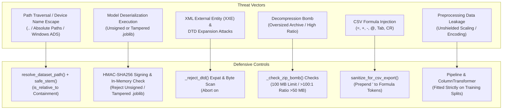

# Security Policy

## 1. Supported Versions

| Version | Status |
| ------- | ------ |
| 2.2.x   | Supported |

---

## 2. Reporting a Vulnerability

If you discover a security vulnerability in TabuLens:
1. Do not open a public issue.
2. Report the vulnerability privately to the repository maintainer.
3. Include reproduction steps, environment details, and the affected version.

---

## 3. Threat Model and Trust Assumptions

### 3.1 Operating Scope
- **Deployment model:** Single-user analytical workbench running locally on `127.0.0.1:8501` or in a local Docker container as non-root `appuser`.
- **Primary trust boundary:** Incoming datasets (`CSV`, `TSV`, `Parquet`, `Excel`, `XML`, `HTML`, `JSON`, `JSONL`, `SQLite`) and serialized `.joblib` model bundles are treated as untrusted inputs until validated.
- **Key confidentiality assumption:** Model signature verification relies on OS file permissions protecting `Models/.model_signing_key` (`0o600`). HMAC-SHA256 proves local artifact integrity under that key; it does not provide asymmetric cross-host trust.

### 3.2 Threat Vectors and Defensive Controls

---

## 4. Defensive Controls Matrix

| Threat Vector | Input Classes Defended | Enforcing Function | Covering Tests |
|---|---|---|---|
| **Path Traversal & Device Name Escapes** | Traversal tokens (`..`), leading slashes, drive-relative paths, Windows Alternate Data Streams (`:`), and Windows reserved stems (`CON`, `PRN`, `AUX`, `NUL`, `COM1-9`, `LPT1-9`). | [`utils/paths.py::resolve_dataset_path`](utils/paths.py) [`utils/paths.py::safe_stem`](utils/paths.py) | `tests/test_security_boundaries.py` `tests/test_core_pipeline.py` |
| **Pickle Deserialization Code Execution** | Unsigned `.joblib` bundles, tampered bytes, forged `.joblib.sig` files, mismatched `model_file` names, or paths outside `Models/`. | [`utils/ml.py::load_trained_model`](utils/ml.py) [`utils/model_security.py::verify_model_artifact_signature`](utils/model_security.py) | `tests/test_security_boundaries.py` `tests/test_inference_script_generation.py` |
| **XML External Entity (XXE) & DTD Injection** | XML files containing `<!DOCTYPE` or `<!ENTITY` declarations (including UTF-16/UTF-32 encodings). | [`utils/markup_parsing.py::_reject_dtd`](utils/markup_parsing.py) | `tests/test_security_boundaries.py` `tests/test_ingestion_parsers.py` |
| **ZIP Decompression Bomb** | `.xlsx` archives exceeding 100 MB uncompressed, or exceeding a 100:1 expansion ratio when uncompressed size exceeds 50 MB. | [`utils/paths.py::_check_zip_bomb`](utils/paths.py) | `tests/test_ingestion_parsers.py` |
| **CSV Formula Injection** | String cells or headers beginning with `=`, `+`, `-`, `@`, `\t`, or `\r` (unless parsed as valid numeric literals). | [`utils/frames.py::sanitize_for_csv_export`](utils/frames.py) | `tests/test_security_boundaries.py` `tests/test_audit_regressions.py` |
| **Resource Exhaustion** | Uploads `> 200 MB` (`> 250 MB` / `> 20` files batch), tables `> 1,000,000` rows, `> 200` columns, or `> 20,000,000` cells, and DataFrames `> 400 MB` deep RAM. | [`utils/paths.py::read_tabular`](utils/paths.py) [`utils/parsing.py`](utils/parsing.py) [`utils/limits.py`](utils/limits.py) | `tests/test_security_boundaries.py` `tests/test_ingestion_parsers.py` |

---

## 5. Implementation Details

### 5.1 Model Deserialization Boundary
- `load_trained_model()` restricts loading to `MODELS_DIR` (`Models/`) unless `trusted=True` is passed explicitly in internal test fixtures (which logs a warning).
- `save_trained_model()` and `sign_model_artifact()` generate a 32-byte key at `Models/.model_signing_key` via `os.open(..., os.O_CREAT | O_EXCL | os.O_WRONLY, 0o600)`.
- `load_trained_model()` reads file bytes into memory (`<= 100 MB`), validates the `.joblib.sig` HMAC-SHA256 digest via `hmac.compare_digest`, and deserializes `io.BytesIO(content)` to eliminate TOCTOU swaps between verification and loading.

### 5.2 Export & Error Redaction
- Internal working DataFrames remain unescaped in memory so numerical statistics are unaffected; exports written via `sanitize_for_csv_export()` neutralize spreadsheet formulas.
- `utils/theme.py::safe_error_boundary` and `sanitize_error_message()` redact local filesystem paths before rendering UI error banners, and `.streamlit/config.toml` sets `showErrorDetails = false`.
