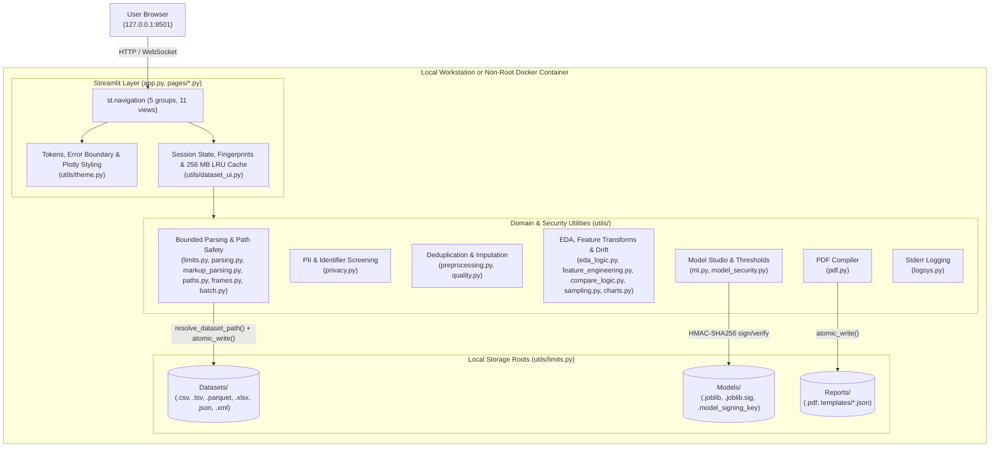

# TabuLens — System Architecture

TabuLens is a local-first tabular analytics and machine learning workbench built with Python, Streamlit, pandas, SciPy, scikit-learn, Plotly, and ReportLab. Presentation views in `app.py` and `pages/` stay thin and delegate parsing, statistics, modeling, signing, and rendering to decoupled modules in `utils/`.

---

## 1. Architectural Principles

1. **Local Execution:** All ingestion, exploratory diagnostics, model training, inference, and PDF generation execute locally without external API dependencies ([ADR-001](decisions/0001-local-first-tabular-workbench.md)).
2. **Bounded Resource Policy:** Untrusted files pass through centralized byte, row, column, deep-memory, string-cardinality, ZIP-ratio, and DTD guards before entering UI workflows ([ADR-005](decisions/0005-bounded-ingestion-and-memory-ceilings.md)).
3. **Cryptographic Deserialization Gate:** Serialized `.joblib` model bundles require HMAC-SHA256 verification against `Models/.model_signing_key` in memory prior to `joblib.load()` ([ADR-004](decisions/0004-hmac-signed-model-artifacts.md)).
4. **Pipeline-Encapsulated ML:** Imputation, scaling, and one-hot encoding execute inside scikit-learn `Pipeline` and `ColumnTransformer` objects fitted on training splits ([ADR-002](decisions/0002-leak-free-pipelines-and-threshold-tuning.md)).
5. **Multiple-Testing Control:** Continuous column drift uses two-sample Kolmogorov-Smirnov tests adjusted jointly with Benjamini-Hochberg FDR ($Q = 0.05$), paired with categorical Total Variation Distance ([ADR-003](decisions/0003-statistical-drift-ks-fdr-and-tvd.md)).

---

## 2. System Diagram

---

## 3. Component Breakdown

### 3.1 Presentation Layer (`app.py` and `pages/`)
`app.py` resolves package version metadata, configures Streamlit, generates deterministic synthetic benchmarks (`saas_customers_q1.csv`, `saas_customers_q2_drifted.csv`, `housing_market_prices.csv`) on request, and mounts `st.navigation` across five groups:

- **Overview:** Workspace Home (`app.py`), Data Health & Profiler (`pages/dashboard.py`).
- **Data Management:** Data Hub & Ingest (`pages/upload.py`), Data Cleaning & Imputation (`pages/cleaning.py`), Feature Engineering Studio (`pages/feature_engineering.py`).
- **Exploratory Analysis:** Statistical Diagnostics (`pages/eda.py`), Interactive Visual Analytics (`pages/visualization.py`), Dataset Drift & Compare (`pages/compare.py`).
- **Machine Learning:** Model Studio & Training (`pages/ml.py`), Batch Scoring & Simulation (`pages/predict.py`).
- **Audit & Reports:** Data Science Audit Report (`pages/report.py`).

### 3.2 Ingestion, Parsing, and Storage (`utils/limits.py`, `utils/parsing.py`, `utils/markup_parsing.py`, `utils/paths.py`, `utils/frames.py`, `utils/batch.py`)
- **Resource policy (`utils/limits.py`):** Defines canonical ceilings (`MAX_UPLOAD_BYTES = 200 MB`, `MAX_AGGREGATE_UPLOAD_BYTES = 250 MB`, `MAX_UPLOAD_FILES = 20`, `MAX_INGESTION_ROWS = 1_000_000`, `MAX_INGESTION_COLUMNS = 200`, `MAX_INGESTION_CELLS = 20_000_000`, `MAX_DATAFRAME_MEMORY_BYTES = 400 MB`, `MAX_HIGH_CARDINALITY_STRING_CELLS = 5_000_000`) and storage directories (`Datasets/`, `Models/`, `Reports/`).
- **Format parsers (`utils/parsing.py`, `utils/markup_parsing.py`):**
  - `CSV`/`TSV`: Header-width pre-check, delimiter detection (`,`, `;`, `\t`, `|`), chunked streaming (`chunksize=25_000`), and string-cardinality amplification checks.
  - `XLSX`/`XLS`: `_check_zip_bomb()` checks 100 MB uncompressed ceiling and `>100:1` compression ratios above 50 MB prior to `pd.read_excel()`.
  - `JSON`/`JSONL`/`NDJSON`: Incremental row-bounded streaming (`_stream_json_from_buffer`, `_stream_json_array`), 2 MB cap on unstreamable objects, and column count enforcement.
  - `Parquet`: PyArrow metadata inspection and `iter_batches()` row-bounded reads.
  - `XML`/`HTML`: Custom SAX DTD/entity rejection (`_reject_dtd`), bounded depth (`MAX_XML_DEPTH = 50`), and largest-table HTML extraction via `_HTMLTableParser`.
  - `SQLite`: Handled in `pages/upload.py` via temporary upload extraction and `pd.read_sql_query`.
  - `TXT`/`PDF`: Delimited text sniffing via `csv.Sniffer`; non-tabular text and extracted PDF text (capped at 30 pages / 50,000 chars) raise `AIConversionRequired` carrying a text preview.
- **Path containment & atomicity (`utils/paths.py`, `utils/frames.py`, `utils/batch.py`):** `resolve_dataset_path()` and `safe_stem()` block traversal, Windows ADS (`:`), and Windows reserved device names; `get_unique_filename()` uses `O_CREAT | O_EXCL` `.reserve` markers; `atomic_write()` writes temp files and replaces atomically; `sanitize_for_csv_export()` escapes spreadsheet formula prefixes (`=`, `+`, `-`, `@`, `\t`, `\r`); `merge_frames()` adds a collision-free provenance column when merging multi-file uploads.

### 3.3 Session Identity, Quality, Privacy, and Cleaning (`utils/dataset_ui.py`, `utils/quality.py`, `utils/privacy.py`, `utils/preprocessing.py`)
- **Identity & cache (`utils/dataset_ui.py`):** SHA-256 disk (`dataset_fingerprint`) and DataFrame (`dataframe_fingerprint`) hashing detect stale cached results or on-disk file swaps (`results_match_active`). `BoundedDatasetMemoryCache` holds deep-copied DataFrames under a 256 MB LRU budget.
- **Hygiene (`utils/quality.py`):** Shared `quality_metrics()` / `quality_index()` ensures `pages/dashboard.py` and `utils/pdf.py` report identical completeness, uniqueness, and composite index values.
- **Privacy screening (`utils/privacy.py`):** Heuristic name/token and 100-row sample checks flag likely identifiers, emails, phone numbers, Luhn-valid card numbers, IBANs, and secret tokens.
- **Preprocessing (`utils/preprocessing.py`):** Deduplication, numeric/categorical/datetime imputation, and complete-case row dropping.

### 3.4 EDA, Feature Engineering, Visualization, and Drift (`utils/eda_logic.py`, `utils/feature_engineering.py`, `utils/charts.py`, `utils/compare_logic.py`, `utils/sampling.py`)
- **Statistical diagnostics (`utils/eda_logic.py`):** VIF (`calculate_vif`), Tukey IQR fences and Z-scores (`detect_tukey_outliers`, `audit_outliers`, `compute_outlier_summary`), and one-way ANOVA (`calculate_anova`).
- **Feature engineering (`utils/feature_engineering.py`):** Scaling, encoding, power transforms, pairwise interactions, and Mutual Information scoring on the active frame.
- **Visualization & sampling (`utils/sampling.py`, `utils/charts.py`):** Caps visualizations at 25,000 rows (`downsample_timeseries` preserves min/max envelope and endpoints per chronological bucket) and statistical analysis at 50,000 rows.
- **Drift auditing (`utils/compare_logic.py`):** `schema_diff()`, `benjamini_hochberg_correction()`, and `column_drift_rows()`.

### 3.5 Modeling, Security, and Reporting (`utils/ml.py`, `utils/model_security.py`, `utils/pdf.py`, `utils/theme.py`, `utils/logsys.py`)
- **ML & inference (`utils/ml.py`):** Automated classification/regression inference, ID-column screening, `ColumnTransformer` + `Pipeline`, cross-validation, dummy baselines, binary threshold evaluation (`evaluate_threshold_metrics`), batch scoring with unseen-category warnings (`predict_with_model`), and standalone script synthesis (`generate_standalone_inference_code`).
- **Model signing (`utils/model_security.py`):** `0o600` key initialization (`O_CREAT | O_EXCL`), `.joblib.sig` signing, and constant-time `hmac.compare_digest` validation.
- **PDF reports (`utils/pdf.py`):** ReportLab report assembly with Unicode font resolution, optional Matplotlib charts, and sensitive-column redaction.
- **UI & logging (`utils/theme.py`, `utils/logsys.py`):** Theme helpers, `sanitize_error_message()` / `safe_error_boundary()`, and stderr logging controlled via `TABULENS_LOG_LEVEL` (with fallback to `CLOUDINSIGHT_LOG_LEVEL`).
