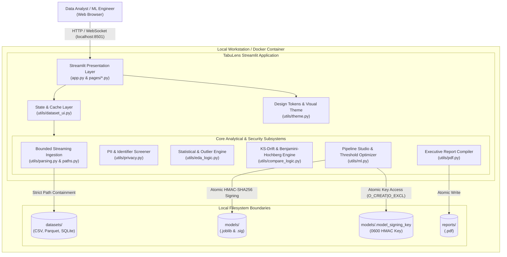

# TabuLens — System Architecture

TabuLens is a local-first, privacy-governed tabular data science and machine learning studio built with Python, Streamlit, and Scikit-Learn. It provides an end-to-end environment for tabular data exploration, distribution drift auditing, feature engineering, leak-free machine learning training with decision threshold tuning, and standalone inference script generation.

---

## 1. Architectural Principles

1. **Local-First & Data Sovereign:** All data ingestion, transformation, exploratory statistical diagnostics, and ML model training occur strictly on the local workstation. Data never leaves the machine.
2. **Deterministic & Bounded Resource Usage:** Untrusted user input is handled through strict resource bounds: 200 MB maximum file uploads, 20M cell limits, anti-XXE stream parsing, ZIP expansion ratio checks (<100x), path traversal guards, and CSV formula injection sanitization.
3. **Cryptographic Artifact Integrity:** Machine learning models serialized via `joblib` are signed with HMAC-SHA256. Unsigned or modified bundles are rejected before deserialization to eliminate arbitrary code execution risks.
4. **Leak-Free ML Modeling:** Imputation, categorical one-hot encoding, and feature scaling occur strictly inside scikit-learn `Pipeline` and `ColumnTransformer` estimators fitted solely on training subsets.
5. **Statistical Rigor:** Hypothesis tests for drift (Kolmogorov-Smirnov) incorporate Benjamini-Hochberg False Discovery Rate (FDR) adjustments ($Q = 0.05$) to guard against false-positive drift alarms across wide feature sets.

---

## 2. System Context & Container Diagram (C4 Model)

---

## 3. Component Breakdown

### 3.1 Presentation & Navigation Layer (`app.py` & `pages/`)
Uses modern Streamlit `st.navigation` with a logical 4th-year studio workflow:
- **Overview:** Workspace Home, Data Health & Profiler (`pages/dashboard.py`).
- **Data Management:** Data Hub & Ingest (`pages/upload.py`), Data Cleaning & Imputation (`pages/cleaning.py`), Feature Engineering Studio (`pages/feature_engineering.py`).
- **Exploratory Analysis:** Statistical & Outlier Diagnostics (`pages/eda.py`), Interactive Visual Analytics (`pages/visualization.py`).
- **Machine Learning:** Model Studio & Threshold Tuning (`pages/ml.py`), Batch Scoring & Standalone Export (`pages/predict.py`).
- **Audit & Reports:** Dataset Drift & Comparison (`pages/compare.py`), Data Science Audit Report (`pages/report.py`).

### 3.2 Bounded Ingestion & Parser Subsystem (`utils/parsing.py`, `utils/paths.py`, `utils/limits.py`)
- Dispatches multi-format ingestion based on extension and content sniffing:
  - `CSV` / `TSV`: Header-width inspection, adaptive dialect sniffing (`,`, `;`, `\t`, `|`), streaming chunk parsing.
  - `XLSX` / `XLS`: ZIP decompression ratio checks (<100x ratio, 100 MB uncompressed limit) preventing decompression bombs.
  - `JSON` / `JSONL`: Streaming scalar validation, column count bounding (<=200 columns).
  - `XML`: Custom hardened SAX parser rejecting DTDs (`<!DOCTYPE`) and external entity expansions (`<!ENTITY`).
  - `Parquet`: Strict schema decoding with chunk row caps.
  - `SQLite`: Table reflection and row-capped read streaming.
- Strict path containment via `resolve_dataset_path()` ensures all file operations remain inside `DATASETS_DIR` without directory traversal.

### 3.3 Security & Privacy Subsystem (`utils/privacy.py`, `utils/frames.py`)
- **PII & Data Screening:** Scans column headers and sampled row values using regexes and Luhn algorithms to detect emails, phone numbers, SSNs, credit card numbers, JWT tokens, and database primary keys.
- **CSV Formula Sanitization:** Neutralizes DDE and formula injection attacks by prepending single quotes (`'`) to cells starting with `=`, `+`, `-`, `@`, `\t`, `\r`.

### 3.4 Machine Learning Engine (`utils/ml.py`)
- **Automated Problem Detection:** Analyzes target cardinality and data types to infer binary classification, multi-class classification, or continuous regression.
- **Leak-Free Pipelines:** Preprocessing is encapsulated in `Pipeline` and `ColumnTransformer`:
  - Numeric features: `SimpleImputer(strategy="median")` + `StandardScaler()`
  - Categorical features: `SimpleImputer(strategy="most_frequent")` + `OneHotEncoder(handle_unknown="ignore")`
- **Validation Engine:** 5-fold cross-validation (`StratifiedKFold` for classification, `KFold` for regression, or `TimeSeriesSplit` for chronological sequences). Compares against naive `DummyClassifier` or `DummyRegressor` baselines.
- **Decision Threshold Optimization:** For binary classifiers, evaluates precision, recall, F1, and Matthews Correlation Coefficient (MCC) across candidate cutoffs from 0.05 to 0.95 ($O(1)$ lookup from pre-computed probabilities).
- **Standalone Inference Generation:** Exports a self-contained Python script (`predict_standalone.py`) that loads the model bundle, validates input schema, verifies HMAC signatures, and runs batch predictions without Streamlit.
- **Model Signing & Tamper Evidence:** HMAC-SHA256 signature calculated over serialized model bytes and stored in `.joblib.sig`. Load operations verify HMAC before calling `joblib.load()`.

### 3.5 Executive Reporting Engine (`utils/pdf.py`)
- Compiles publication-ready PDF reports via ReportLab.
- Embeds summary statistics, dataset health metrics, drift audit tables, and model performance benchmarks.
