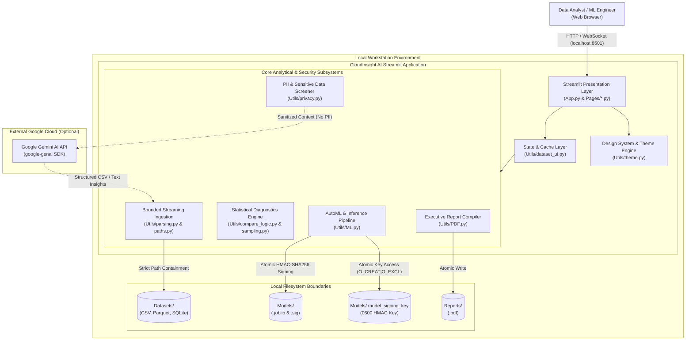
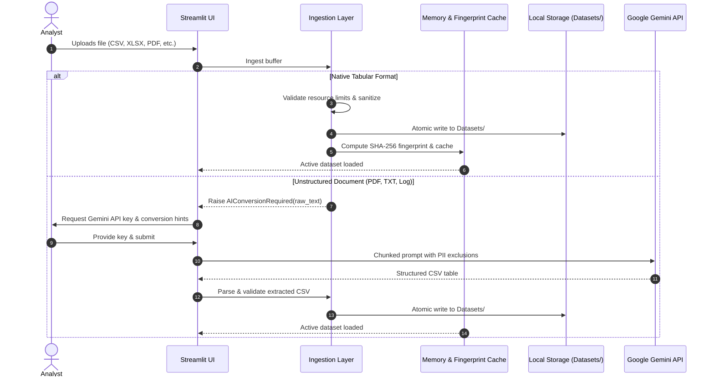

# CloudInsight AI — System Architecture

CloudInsight AI is a local-first, privacy-governed data analytics and machine learning studio built for tabular data exploration, statistical auditing, feature engineering, AutoML model development, and PDF reporting.

---

## 1. Architectural Principles

1. **Local-First & Data Sovereign:** All data ingestion, transformation, exploratory statistical diagnostics, and ML model training occur strictly on the local workstation. Data never leaves the machine unless the user explicitly invokes an optional Google Gemini feature.
2. **Ephemeral External Credentials:** API keys for Google Gemini are held in Streamlit's ephemeral `session_state` only. Credentials are never written to disk, committed to configuration files, or leaked into application logs.
3. **Defense in Depth Across File Formats:** Untrusted user input is handled through strict resource bounds, anti-XXE stream parsing, ZIP expansion ratio checks, path traversal guards, and formula injection sanitization.
4. **Cryptographic Artifact Integrity:** Machine learning models serialized via `joblib` are signed with HMAC-SHA256. Unsigned or modified bundles are rejected before deserialization to eliminate arbitrary code execution risks.
5. **Leak-Free ML Modeling:** Imputation, categorical encoding, and feature scaling occur inside isolated scikit-learn `Pipeline` and `ColumnTransformer` pipelines fitted strictly on training subsets.

---

## 2. System Context & Container Diagram (C4 Model)

---

## 3. Component Breakdown

### 3.1 Presentation & Navigation Layer (`App.py` & `Pages/`)
- Uses modern Streamlit `st.navigation` to define functional domains:
  - **Overview:** Workspace Home, Data Health & Profiler (`Pages/Dashboard.py`).
  - **Data Management:** Data Hub & Ingest (`Pages/Upload.py`), Data Cleaning & Imputation (`Pages/Cleaning.py`), Feature Engineering Studio (`Pages/FeatureEngineering.py`).
  - **Exploratory Analysis:** Statistical Diagnostics (`Pages/EDA.py`), Interactive Visual Analytics (`Pages/Visualization.py`).
  - **Machine Learning:** Model Studio & Training (`Pages/ML.py`), Batch Scoring & Simulation (`Pages/Predict.py`).
  - **AI & Gemini Assistant:** AI File Converter (`Pages/AIConverter.py`), AI Summary & Insights (`Pages/AI.py`), Ask AI (Chat) (`Pages/AIChat.py`).
  - **Audit & Reports:** Dataset Drift & Compare (`Pages/Compare.py`), Data Science Audit Report (`Pages/Report.py`).

### 3.2 Bounded Ingestion & Parser Subsystem (`Utils/parsing.py`, `Utils/paths.py`, `Utils/limits.py`)
- Dispatches multi-format ingestion based on extension and content sniffing:
  - `CSV` / `TSV`: Header-width inspection, adaptive dialect sniffing (`,`, `;`, `\t`, `|`), streaming chunk parsing.
  - `XLSX` / `XLS`: ZIP decompression ratio checks (<100x ratio, 100 MB uncompressed limit) preventing zip bombs.
  - `JSON` / `JSONL`: Streaming scalar validation, column count bounding (<=200 columns).
  - `XML`: Custom hardened SAX parser rejecting DTDs (`<!DOCTYPE`) and external entity expansions (`<!ENTITY`).
  - `Parquet`: Strict schema decoding with chunk row caps.
- Strict containment via `resolve_dataset_path()` ensuring all file operations remain inside `DATASETS_DIR` without directory traversal.

### 3.3 Security & Credential Subsystem (`Utils/secrets.py`, `Utils/privacy.py`, `Utils/frames.py`)
- **Credential Isolation:** API keys exist solely in `st.session_state["gemini_secret"]`. Rotated inline widget keys prevent browser auto-fill retention.
- **PII & Data Screening:** Scans column headers and sampled row values using regexes and Luhn algorithms to detect emails, phone numbers, IBANs, credit card numbers, JWT tokens, and database primary keys. Identified columns are pre-excluded from AI prompts.
- **CSV Formula Sanitization:** Neutralizes DDE and formula injection attacks by prepending single quotes (`'`) to cells starting with `=`, `+`, `-`, `@`, `\t`, `\r`.

### 3.4 Machine Learning Engine (`Utils/ML.py`)
- **Automated Problem Detection:** Analyzes target cardinality and data types to infer binary classification, multi-class classification, or continuous regression.
- **Leak-Free Pipelines:** Preprocessing is encapsulated in `Pipeline` and `ColumnTransformer`:
  - Numeric features: `SimpleImputer(strategy="median")` + `StandardScaler()`
  - Categorical features: `SimpleImputer(strategy="most_frequent")` + `OneHotEncoder(handle_unknown="ignore")`
- **Validation Engine:** 5-fold cross-validation (`StratifiedKFold` for classification, `KFold` for regression, or `TimeSeriesSplit` for chronological sequences). Compares against naive `DummyClassifier` or `DummyRegressor` baselines.
- **Model Signing & Tamper Evidence:** HMAC-SHA256 signature calculated over serialized model bytes and stored in `.joblib.sig`. Load operations verify HMAC before calling `joblib.load()`.

### 3.5 Executive Reporting Engine (`Utils/PDF.py`)
- Compiles publication-ready PDF reports via ReportLab.
- Encapsulates dataset hygiene index gauges, descriptive statistics tables, IQR outlier audits, Pearson correlation matrices, and optional high-DPI matplotlib visualizations.
- Resolves system TrueType Unicode fonts (SimSun, Microsoft YaHei, Malgun Gothic, DejaVu Sans) for robust multi-language symbol rendering.

---

## 4. Data Flow Lifecycle

---

## 5. Architectural Trade-offs & Design Decisions

| # | Architectural Decision | Alternative Considered | Chosen Design & Implementation | Principal Trade-off Analysis |
|---|---|---|---|---|
| **1** | **Local-First Workstation Sovereignty vs. Multi-Tenant SaaS** | Cloud-hosted multi-tenant SaaS (AWS/GCP/Snowflake) with centralized object storage and API proxies. | Single-process local execution bound to `127.0.0.1:8501`. All parsing, caching, and model training occur strictly in workstation RAM and local disk (`Datasets/`, `Models/`). | **Gain:** Eliminates corporate data residency risks (GDPR, HIPAA, SOC 2 Type II); eliminates cloud ingress/egress transit costs and latency; zero persistence of proprietary data on remote servers. **Sacrifice:** Lacks real-time multi-user simultaneous editing and horizontal compute auto-scaling; memory capacity is bounded by local workstation physical RAM. |
| **2** | **Cryptographic HMAC-SHA256 Model Integrity vs. ONNX Runtime vs. Unrestricted Pickle** | (a) Unrestricted `pickle`/`joblib` deserialization. (b) ONNX runtime compilation. (c) Custom JSON weight serializers. | Symmetric HMAC-SHA256 cryptographic signatures stored in `.joblib.sig`. Load routines compute digest and verify against `Models/.model_signing_key` (`0600` permissions, `O_CREAT \| O_EXCL`) before calling `joblib.load()`. | **Gain:** Eliminates arbitrary Python bytecode execution (RCE) via `__reduce__` from untrusted or corrupted model files; avoids heavy C++ runtime dependencies (`onnxruntime`); preserves native Scikit-Learn custom pipeline estimators without translation loss. **Sacrifice:** Assumes single-user OS boundary security; a local root attacker with write permissions to `Models/.model_signing_key` could forge signatures. |
| **3** | **Bounded Streaming Pre-Inspection & Memory Ceilings vs. Unbounded Loading** | Eager in-memory loading via default `pandas.read_csv()` or unbounded Polars lazy evaluation. | Multi-tier bounded streaming pre-inspection: 200 MB file cap, dialect sniffing, pre-parse row/col/cell counting (1M rows, 200 cols, 20M cells), 5M high-cardinality string guard, and deep DataFrame memory ceiling (400 MB). | **Gain:** Eliminates workstation Out-Of-Memory (OOM) operating system freezes; prevents zip bombs and XML entity expansion denial-of-service; deterministic memory budgeting. **Sacrifice:** Rejects arbitrarily massive big-data workloads (>1M rows, >400 MB RAM) that require distributed compute clusters (Spark/Ray). |
| **4** | **Encapsulated Scikit-Learn `Pipeline` & `ColumnTransformer` vs. Ad-Hoc Preprocessing** | Manual preprocessing (scaling, imputation, one-hot encoding) performed across the full dataset prior to train/test splitting. | Strict encapsulation of transformers and estimators within unified Scikit-Learn `Pipeline` and `ColumnTransformer` objects. All transformations are fitted strictly on training folds inside 5-fold cross-validation. | **Gain:** Mathematically guarantees zero data leakage from validation/holdout sets into training folds; produces atomic, self-contained model artifacts that directly score raw un-preprocessed inference data without custom glue code. **Sacrifice:** Higher pipeline serialization complexity; requires rigid column schema alignment during batch inference. |
| **5** | **Ephemeral In-Memory Secret Isolation vs. Disk/Database Vaults** | Local `.env` files, SQLite secret tables, or operating system keyring services. | Pure in-memory credential storage in Streamlit `st.session_state["gemini_secret"]` wrapped in `temporary_secret` context managers that purge secrets upon task completion. Automated PII detection excludes sensitive attributes before prompt dispatch. | **Gain:** Zero secret persistence footprint; API keys never touch persistent media, logs, or backups; leak prevention is absolute across Git workflows. **Sacrifice:** Requires analysts to provide API keys per session; keys do not persist across browser restarts unless cached in active session memory. |

---

## 6. Execution Lifecycle, Concurrency & Memory Accounting

### 6.1 Streamlit Execution Model & State Isolation
Streamlit operates on a single-process Python interpreter model. Client widget interactions cause the active page script to re-evaluate top-to-bottom. To preserve data consistency across re-runs:
- **`st.session_state`**: Stores lightweight UI session variables (active dataset name, selected target column, hyperparameters, and ephemeral API keys).
- **Dataset Memory Cache (`Utils/dataset_ui.py`)**: Implements `BoundedDatasetMemoryCache` protected by a re-entrant mutex (`threading.RLock`). Datasets are registered with SHA-256 content hashes, providing copy-on-read memory isolation across page navigations.

### 6.2 Deep In-Memory Memory Budget Accounting
Standard shallow memory estimation (`df.info(memory_usage="shallow")`) only accounts for fixed-width C data types, drastically undercounting object columns (variable-length Python strings) by omitting pointer target memory. CloudInsight AI enforces deep inspection:
$$\text{Memory}_{\text{deep}} = \sum_{c \in \text{columns}} \text{memory\_usage}(c, \text{deep}=\text{True})$$
Ingested DataFrames exceeding `MAX_DATAFRAME_MEMORY_BYTES` (400 MB / 419,430,400 bytes) are aborted immediately before entering the cache, preventing heap fragmentation and workstation OOM crashes.

### 6.3 Centralized Resource Ceilings Reference

All computational ceilings are centralized in `Utils/limits.py` (`ResourcePolicy`):

| Boundary Parameter | Ceiling | Enforcement Point | Technical Rationale & Failure Mode Defended |
|---|---|---|---|
| `MAX_UPLOAD_BYTES` | **200 MB** (209,715,200 B) | `Utils/parsing.py::read_tabular` | Matches Streamlit buffer ceiling; prevents socket buffer memory exhaustion. |
| `MAX_AGGREGATE_UPLOAD_BYTES` | **250 MB** (262,144,000 B) | `Utils/parsing.py::read_tabular_multi` | Batch upload ceiling for multi-file merges; bounds staging I/O buffers. |
| `MAX_UPLOAD_FILES` | **20 files** | `Pages/Upload.py` | Caps batch file descriptor allocation and merge overhead. |
| `MAX_INGESTION_ROWS` | **1,000,000 rows** | `Utils/parsing.py::read_tabular` | Streaming chunk validation rejects oversized tables before DataFrame materialization. |
| `MAX_INGESTION_COLUMNS` | **200 columns** | `Utils/parsing.py::read_tabular` | Header parser guard; protects against horizontal dimension explosion and $O(N^2)$ correlation matrices. |
| `MAX_INGESTION_CELLS` | **20,000,000 cells** | `Utils/parsing.py::read_tabular` | Global cell matrix ceiling ($rows \times columns$); bounds memory footprint regardless of aspect ratio. |
| `MAX_COMBINED_ROWS` | **1,000,000 rows** | `Utils/parsing.py::read_tabular_multi` | Total row ceiling across concatenated multi-file tabular uploads. |
| `MAX_DATAFRAME_MEMORY_BYTES` | **400 MB** (419,430,400 B) | `Utils/limits.py`, `Utils/parsing.py` | Deep memory inspection ceiling (`df.memory_usage(deep=True).sum()`); fails closed if object overhead exceeds RAM budget. |
| `MAX_HIGH_CARDINALITY_STRING_CELLS` | **5,000,000 cells** | `Utils/parsing.py::read_tabular` | Pre-allocation guard against high-cardinality string columns which incur massive pointer indirection overhead in CPython. |
| `MAX_MODEL_FILE_SIZE` | **100 MB** (104,857,600 B) | `Utils/ML.py::load_trained_model` | Model deserialization guard; rejects bloated binary archives before HMAC verification. |
| `MAX_VISUALIZATION_ROWS` | **25,000 rows** | `Utils/sampling.py::sample_for_chart` | Interactive Plotly rendering limit; downsamples continuous series via Largest Triangle Three Buckets (LTTB) / stratified sampling to maintain 60 FPS UI responsiveness. |
| `MAX_ANALYSIS_ROWS` | **50,000 rows** | `Utils/compare_logic.py` | Statistical diagnostics and drift computation ceiling (`COMPARE_MAX_ANALYSIS_ROWS`); bounds $O(N \log N)$ sorting and pairwise distance operations. |
| **Decompression Ratio Ceiling** | **100:1 ratio** (100 MB uncompressed) | `Utils/paths.py::_check_zip_bomb` | Pre-extraction inspection of `.xlsx` archive headers to defend against recursive decompression bombs. |
