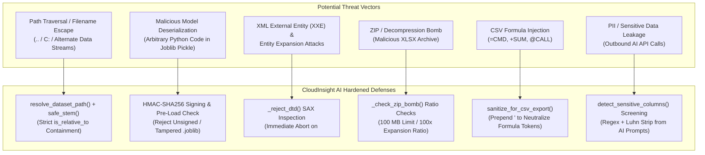

# CloudInsight AI — Security & Threat Modeling Architecture

CloudInsight AI is designed as a local-first, privacy-governed analytical tool. This document defines the application's threat model, security controls, and verification boundaries aligned with the **OWASP Application Security Verification Standard (ASVS 5.0.0)** and **NIST SP 800-218 (Secure Software Development Framework)**.

---

## 1. Threat Model & Trust Assumptions

### 1.1 Architecture & Operating Scope
- **Deployment Model:** Single-user local analytical desktop application executed on `127.0.0.1:8501`.
- **Primary Trust Boundary:** All incoming files (CSV, Parquet, Excel, XML, JSON, PDF, and trained `.joblib` model bundles) originate from untrusted external sources and must be strictly validated before parsing or execution.
- **Local User Context:** The application process runs under the local user's operating system permissions. It relies on the local OS kernel to isolate processes and enforce filesystem read/write privileges.

---

## 2. Threat Modeling Matrix & Standards Mapping



### 2.1 Threat Vector & Standards Alignment Matrix

| Threat Vector | OWASP ASVS v5.0.0 | NIST SP 800-218 | Concrete Attack Payload Defended | CloudInsight AI Defensive Mechanism |
|---|---|---|---|---|
| **T1: Path Traversal** | **ASVS 12.1.1** | **PW.1.1** | `../../../../Windows/System32/drivers/etc/hosts`, `C:boot.ini`, `data.csv:stream` | `resolve_dataset_path()` enforces `Path.is_relative_to(DATASETS_DIR)`, strips traversal tokens and Windows ADS colons. |
| **T2: Pickle Deserialization RCE** | **ASVS 5.5.1, 6.2.1** | **PW.1.1** | `cposix\nsystem\np0\n(S'calc.exe'\np1\ntp2\nRp3.` (`Exploit` with `__reduce__`) | HMAC-SHA256 digest validation over raw bytes against `Models/.model_signing_key` (`0600`) before calling `joblib.load()`. |
| **T3: XML External Entity (XXE)** | **ASVS 5.2.2** | **PW.4.1** | `<!DOCTYPE test [ <!ENTITY xxe SYSTEM "file:///etc/passwd"> ]>` | `_reject_dtd()` scans raw stream for `<!DOCTYPE` and `<!ENTITY>`, raising `ValueError` before XML parser initialization. |
| **T4: ZIP Decompression Bomb** | **ASVS 12.2.1** | **PW.1.1** | 42 KB nested `.xlsx` archive expanding to 10 GB uncompressed XML | `_check_zip_bomb()` inspects zip central directory headers; rejects archives $>100\text{ MB}$ uncompressed or expansion ratio $>100:1$. |
| **T5: CSV Formula Injection (DDE)** | **ASVS 5.2.4** | **PW.4.1** | `=cmd|'/C calc'!A0`, `@SUM(A1:A10)`, `+12345`, `-\tcalc` | `sanitize_for_csv_export()` prepends single quote (`'`) to any string cell beginning with `=`, `+`, `-`, `@`, `\t`, `\r`. |
| **T6: PII / Secret Leakage** | **ASVS 6.4.1, 8.3.1** | **PS.1.1** | Credit cards (Luhn valid), SSNs, API tokens in prompts | `detect_sensitive_columns()` screens headers and values; auto-excludes sensitive attributes; keys kept in RAM only. |

---

## 3. Detailed Security Implementation

### 3.1 Path Traversal & File Containment (`Utils/paths.py`)
- **Control:** `resolve_dataset_path()` verifies that resolved absolute paths are strictly within `DATASETS_DIR`.
- **Defenses:**
  - Rejects `..` path segments.
  - Rejects Alternate Data Streams (Windows `:` notation).
  - Rejects Windows reserved device names (`CON`, `PRN`, `AUX`, `NUL`, `COM1-9`, `LPT1-9`).
  - Guards against drive-relative roots (e.g., `C:filename.csv`).

### 3.2 Model Deserialization & Cryptographic Authenticity (`Utils/ML.py`)
- **Risk:** Python's `pickle` and `joblib` formats allow arbitrary bytecode execution upon deserialization.
- **Control:** Every model artifact produced by CloudInsight is signed with HMAC-SHA256.
  - The signing key is held in `Models/.model_signing_key` (`0600` permissions) initialized with `O_CREAT | O_EXCL` atomic semantics.
  - The signature is stored in `.joblib.sig` containing the SHA-256 HMAC digest and creation timestamp.
  - `load_trained_model()` validates the signature before calling `joblib.load()`. Unsigned, corrupted, or tampered models are rejected immediately.

#### Why Symmetric HMAC-SHA256 Over Asymmetric PKI (RSA/ECDSA)?
- **Workstation Threat Boundary:** In a local-first workstation analytics tool, model generation and model scoring occur within the same security domain (the local user's workstation).
- **Performance & Simplicity:** HMAC-SHA256 is natively available via Python's standard library `hashlib` and `hmac` modules, requiring zero external cryptography wheels (`cryptography` or OpenSSL bindings). Constant-time verification (`hmac.compare_digest`) prevents timing side-channel attacks.
- **Key Initialization Security:** The signing key is initialized at `Models/.model_signing_key` using 256 bits of cryptographically secure random bytes (`secrets.token_bytes(32)`). It is created using `os.open` with `os.O_CREAT | os.O_EXCL` flags and mode `0o600` (read/write restricted strictly to the current user).
- **Trust Boundary Clarification:** HMAC signing defends against accidental corruption, drive-by file poisoning, and loading model bundles downloaded from untrusted public sources. If an attacker achieves local root or user-level write access to the filesystem, they can read the key and forge signatures; host-level defense relies on OS user process separation.

### 3.3 XML External Entity (XXE) & DTD Rejection (`Utils/parsing.py`)
- **Risk:** Malicious XML files can trigger external file reads, network requests, or recursive entity denial of service (Billion Laughs attack).
- **Control:** `_reject_dtd()` inspects the raw XML stream before DOM construction:
  ```python
  if re.search(r"<!DOCTYPE", sample_text, re.IGNORECASE) or re.search(r"<!ENTITY", sample_text, re.IGNORECASE):
      raise ValueError("XML parsing error: DOCTYPE and ENTITY declarations are rejected for security.")
  ```

### 3.4 ZIP Decompression Bomb Guards (`Utils/paths.py`)
- **Risk:** Highly compressed archives in `.xlsx` format can expand to gigabytes in memory, exhausting RAM.
- **Control:** `_check_zip_bomb()` inspects zip headers prior to decompression:
  - Enforces a 100 MB uncompressed aggregate ceiling.
  - Enforces a maximum compression ratio of 100:1. Archives exceeding these thresholds are aborted.

### 3.5 CSV Formula Injection Defense (`Utils/frames.py`)
- **Risk:** Opening exported CSV files in Microsoft Excel or Google Sheets can trigger dynamic data exchange (DDE) or formula execution if cells begin with formula trigger characters.
- **Control:** `sanitize_for_csv_export()` sanitizes all exported text cells:
  - Prepends a single quote (`'`) to any cell starting with `=`, `+`, `-`, `@`, `\t`, or `\r`.

### 3.6 Credential Management & AI Data Boundary (`Utils/secrets.py`, `Utils/privacy.py`)
- **Storage:** No API keys are written to disk, SQLite, environment files, or `.env`. Keys reside purely in `st.session_state["gemini_secret"]`.
- **Lifecycle:** Context manager `temporary_secret` automatically purges secret slots upon task completion unless the user explicitly checks "Keep in session state".
- **PII Stripping:** Outbound prompts to Google Gemini pass through `detect_sensitive_columns()`:
  - Flags emails, phone numbers, IBANs, credit cards (Luhn-verified), and identifiers (`id`, `uuid`, `pk`).
  - Pre-excludes flagged columns from prompt summaries and sample records.
  - Transmits non-sensitive statistical aggregates rather than full raw tables.

---

## 4. Residual Risks & Operational Limitations

1. **Local Physical Workstation Access:** If an attacker has local shell access with write permissions to `Models/.model_signing_key`, they can generate valid signatures for arbitrary models. Defense in depth relies on host-level OS user isolation.
2. **Network Isolation in Multi-User Scenarios:** Running `streamlit run App.py` defaults to `127.0.0.1`. In production deployments across a local network, reverse proxies with authentication (e.g., Nginx with TLS and OAuth/HTTP Basic Auth) are mandatory.
3. **Scanned Image PDFs:** The built-in PDF reader extracts digital text only (`pypdf`); scanned images containing bitmaps require external OCR preprocessing.
